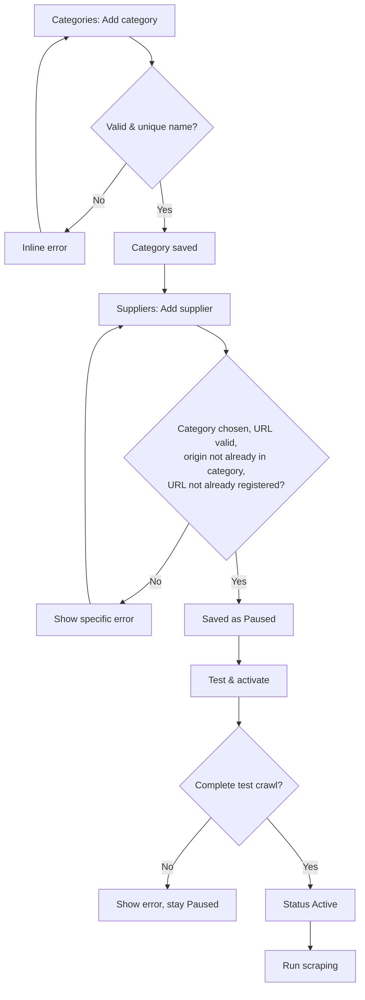
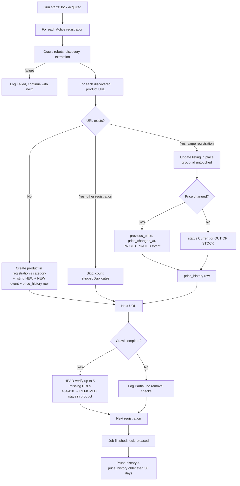
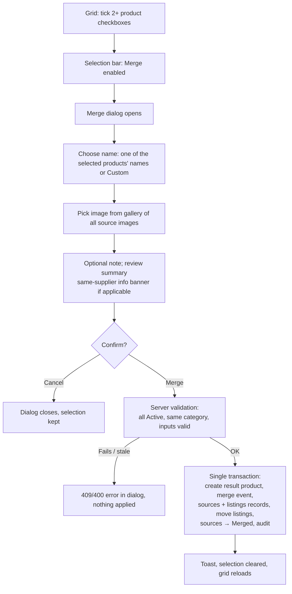
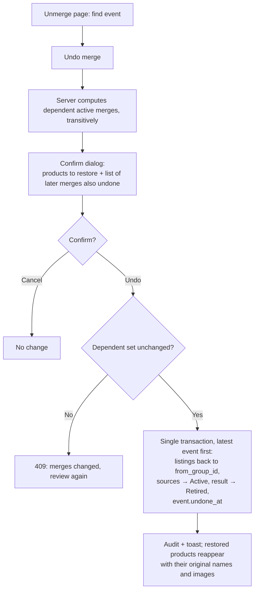
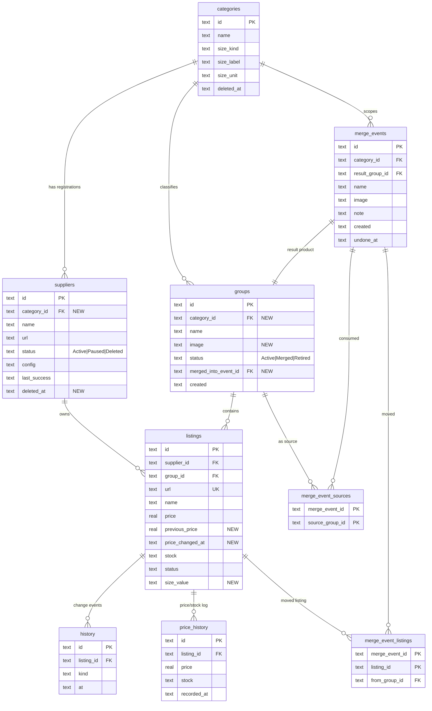

# AnimeCartel Supplier Intelligence — Product Requirements Document

| Field | Value |
|---|---|
| Product | AnimeCartel Supplier Intelligence (repository: `AnimeScraper`) |
| Document version | 1.1 (open questions OQ-2…OQ-7 resolved as D-31…D-36) |
| Date | 2026-11-22 |
| Status | Approved for implementation planning. The only open item is the supplier list (OQ-1). |
| Source baseline | Existing repository code + clarification decisions D-01…D-36. No prior requirements document exists (D-01). |

### Labeling conventions

| Label | Meaning |
|---|---|
| **[EXISTING]** | Verified in the current code. File references are given where useful. |
| **[MODIFY]** | Existing behavior that this release changes. |
| **[NEW]** | Functionality introduced by this release. |
| **[DEPRECATE]** | Existing functionality removed by this release. |
| **[R]** | Recommendation made by the PRD author where the user did not specify. It is not a confirmed decision. It can be changed without re-opening a confirmed decision. |
| **D-nn** | A confirmed clarification decision (see [2.6 Clarification Decision Log](#26-clarification-decision-log)). |

---

## Table of Contents

1. [Document Overview](#1-document-overview)
2. [Product Background](#2-product-background)
3. [Scope](#3-scope)
4. [User Roles and Permissions](#4-user-roles-and-permissions)
5. [Functional Requirements](#5-functional-requirements)
   - [5.1 Categories (FR-CAT)](#51-categories-fr-cat)
   - [5.2 Supplier Registrations (FR-SUP)](#52-supplier-registrations-fr-sup)
   - [5.3 Scraping (FR-SCR)](#53-scraping-fr-scr)
   - [5.4 Comparison Grid (FR-GRID)](#54-comparison-grid-fr-grid)
   - [5.5 Manual Merge (FR-MRG)](#55-manual-merge-fr-mrg)
   - [5.6 Unmerge (FR-UNM)](#56-unmerge-fr-unm)
   - [5.7 Price and Stock History (FR-HIS)](#57-price-and-stock-history-fr-his)
   - [5.8 Existing Pages (FR-PG)](#58-existing-pages-fr-pg)
   - [5.9 Deprecations (FR-DEP)](#59-deprecations-fr-dep)
6. [Detailed User Workflows](#6-detailed-user-workflows)
7. [UI/UX Requirements](#7-uiux-requirements)
8. [Data Model and Relationships](#8-data-model-and-relationships)
9. [API and Backend Requirements](#9-api-and-backend-requirements)
10. [Scraping and AI Requirements](#10-scraping-and-ai-requirements)
11. [Non-Functional Requirements](#11-non-functional-requirements)
12. [Edge Cases and Exception Handling](#12-edge-cases-and-exception-handling)
13. [Dependencies and Risks](#13-dependencies-and-risks)
14. [Acceptance Criteria](#14-acceptance-criteria)
15. [Testing Requirements](#15-testing-requirements)
16. [Implementation Considerations](#16-implementation-considerations)
17. [Open Questions](#17-open-questions)
18. [Appendix A — Traceability Matrix](#appendix-a--traceability-matrix)

---

## 1. Document Overview

### 1.1 Objective

Turn the current supplier-intelligence application into a **category-based price comparison tool**. It shows one product per row and one price column per supplier. Duplicate products are consolidated **only by an explicit user merge**, and every merge can be undone.

### 1.2 Scope summary

The release covers:
- User-managed categories
- Category-bound supplier registrations
- Scraping that lists every product without automatic comparison
- A comparison grid with infinite scroll
- Manual merge with name and image selection
- An Unmerge page with cascading undo
- 30-day price and stock history
- Adjustments to existing pages

AI and similarity matching are removed. Full detail is in [3. Scope](#3-scope).

### 1.3 Intended audience

| Audience | Use of this document |
|---|---|
| Developers | Primary implementation reference: requirements, data model, APIs, rules. |
| QA engineers | Acceptance criteria (Section 14), edge cases (Section 12), test plan (Section 15). |
| Product owner | Confirms scope, decisions and open questions. |

### 1.4 Terminology

| Term | Definition |
|---|---|
| **Category** | A user-managed classification of what a supplier registration fetches, for example Action Figures, Die-cast Models or Katanas. It defines the meaning of *Size* (D-14, D-18). |
| **Supplier registration** (also "supplier") | One row in `suppliers`: a supplier website plus one source URL, bound to exactly one category. The same website can have one registration per category (D-16). |
| **Listing** | One product page scraped from one supplier registration (`listings` row). It is identified globally by its product URL. |
| **Product** | A consolidated item shown as one grid row (`groups` row in the existing schema). A new listing always creates its own product. A merge combines products. |
| **Merge event** | The recorded act of combining ≥2 products into one new product, with the chosen name, image and note (D-09). |
| **Result product** | The new product created by a merge event. |
| **Source product** | A product consumed by a merge event. It is hidden while the merge is active and restored on undo. |
| **Dependent merge** | A later, still-active merge event that consumed (directly or transitively) the result product of an earlier merge event (D-11). |
| **Undo merge / Unmerge** | Reversing a merge event. Source products are restored with their original names and images (D-10). |
| **Size** | The category-specific dimension shown in the grid, for example Height (cm), Length (cm) or Scale (ratio) (D-18). |
| **Display listing** | The listing whose price is shown in a supplier cell when a product has several listings from that supplier (D-12). |
| **Scrape / Run / Job** | One execution of the scraping engine over one or more active registrations (`jobs` row). |
| **OOS** | Out of stock, meaning the listing's `stock` equals `Out of stock`. |

---

## 2. Product Background

### 2.1 Current application overview [EXISTING]

| Aspect | Current implementation (verified) |
|---|---|
| Runtime | Cloudflare Workers. React 19 rendered with Vinext (a Next.js-compatible framework on Vite). Hosted owner-private through the "Sites" platform (`.openai/hosting.json`). |
| Database | Cloudflare D1 (SQLite) through Drizzle ORM. Schema in `db/schema.ts`, migration `drizzle/0000_pretty_falcon.sql`. |
| Tables | `suppliers`, `groups`, `listings`, `history`, `jobs`, `reviews`, `settings`, `audit`. |
| API | A catch-all route `app/api/[...path]/route.ts` dispatches to `lib/service.ts → api()`. `POST /api/run` and `POST /api/scheduled` are handled in `worker/index.ts`. A same-origin check applies to non-GET requests. |
| UI | One page component, `app/page.tsx`. Sidebar tabs: Dashboard, All Products, New Arrivals, Price Changes, Product Matching, Suppliers, Scraping History, Export Reports, Settings. It also has a demo workspace (`lib/demo.ts`). |
| Data loading | `GET /api/state` returns **all** suppliers, groups, listings, jobs, reviews, history (excluding SNAPSHOT/NEW), audit and settings. All filtering, sorting and pagination (48 per page) happen in the browser. |
| Scraping | Adapters `jsonld`, `woocommerce` and `woocommerce-api` (`lib/adapters.ts`, `lib/crawler.ts`). Robots-aware, same-origin, 1 s delay, retries on 429/5xx, 3 MB response cap. A DB run lock (`settings.run_lock`) with recovery after 10 minutes. |
| Change detection | Listing statuses `NEW`, `PRICE UPDATED`, `OUT OF STOCK`, `Current`, `REMOVED`. History kinds `SNAPSHOT` (a full raw copy on every re-scrape), `NEW`, `PRICE UPDATED`, `OUT OF STOCK`, `STOCK UPDATED`, `REMOVED`. Removal needs a HEAD 404/410 on at most 5 missing URLs per supplier per run. |
| Matching | During scraping, every **new** listing is scored with `similarity()` against other suppliers' listings. A score ≥ 0.55 creates a `reviews` row. An optional external vision provider is used via `MATCHING_API_URL`. Approve moves the listing into the target group. |
| Merge | `POST /api/merge {from,to}` moves all listings from one group to another and writes `audit`. The source group is left empty, and the listings moved are not recorded. **It can't be undone.** |
| Categories | `suppliers.category` is free text. The UI offers "Indian wholesaler" and "Independent supplier", which are supplier *types*, not product categories. |
| Products | Every new listing creates its own `groups` row. Groups hold only `id`, `name`, `status` and `created`. Image, height and material come from the first listing. |
| Export | Client-side `.xlsx` with 6 sheets: Product Master, Supplier Listings, New Products, Price Changes, Matching Review, Removed – Unavailable. Scopes: All products, New products, Price changes, Approved groups, Current results, Selected products. |
| Scheduling | `POST /api/scheduled`, called by an external task. Alternate-day at a configurable time, Asia/Kolkata. |
| Authentication | None in the app. Access is restricted by owner-private hosting. |

### 2.2 Business problem

1. **No comparison view.** The catalog shows cards or a list with a single "lowest price". A buyer can't see each supplier's price side by side.
2. **Unwanted and irreversible grouping.** Automatic suggestions created during scraping push unrelated items toward grouping. Merges can't be reversed, so a wrong merge permanently damages the data.
3. **No product categories.** Suppliers sell action figures, die-cast models, katanas and more. These are mixed together, and "size" means different things for each.
4. **Unbounded history growth.** A full raw snapshot is stored for every listing on every scrape.

### 2.3 Proposed solution

- Categories become first-class and user-managed. Each supplier registration belongs to one category.
- Scraping imports every product as-is. There's no matching (D-03, D-05).
- A per-category comparison grid: one product per row, one price column per supplier (D-06, D-07, D-13).
- The user merges products by selecting rows, choosing a name and image, and optionally adding a note (D-04, D-09).
- Every merge is recorded and can be undone from a dedicated Unmerge page, cascading to later merges (D-10, D-11).
- Price and stock history are kept for 30 days (D-24).

### 2.4 Business objectives

| ID | Objective |
|---|---|
| BO-1 | A buyer can compare every active supplier's current price for a product in one row. |
| BO-2 | Product consolidation is entirely under human control and fully reversible. |
| BO-3 | Products are separated by category, with a category-appropriate size attribute. |
| BO-4 | Storage growth stays bounded by the 30-day history retention. |

### 2.5 Expected outcomes (measurable)

| ID | Outcome | Measure |
|---|---|---|
| EO-1 | Side-by-side price comparison | 100% of non-deleted registrations in the selected category appear as a column (unless the user hid it). |
| EO-2 | No automatic grouping | 0 products combined by the system. Each scraped new listing creates exactly 1 product. |
| EO-3 | Reversible consolidation | 100% of active merge events can be undone, restoring source products with their original names and images. |
| EO-4 | Bounded history | No price/stock history row is older than 30 days after the retention job runs. |
| EO-5 | Responsive grid | Meets the NFR-PERF targets in Section 11. |

### 2.6 Clarification Decision Log

All decisions below were confirmed by the product owner during clarification on 2026-11-22.

| ID | Decision |
|---|---|
| D-01 | No original requirements document exists. The repository plus these decisions are the baseline. |
| D-02 | The repository in scope is `~/Desktop/AC_Srapper/AnimeScraper`. |
| D-03 | Scraping must not compare or match products. It lists all products from all registered suppliers. |
| D-04 | Products are never merged automatically. The user merges after visually checking the figures are the same. |
| D-05 | No AI or similarity suggestions anywhere. Merging is fully manual. The Product Matching page is removed. |
| D-06 | Each grid row is a single product. |
| D-07 | Grid columns, in order: merge checkbox, Image, Name, Size, then one price column per supplier. |
| D-08 | 5 suppliers today; plan for up to 10. |
| D-09 | Merge: the user selects 2 or more products (no upper limit). Name: custom, or one of the selected products' names. The user picks the image. An optional note can be added. A merged product can be merged again. |
| D-10 | Unmerge is its own navigation option. It lists merge events with "Undo merge". Undo restores products to their original names (and images). |
| D-11 | Undoing an earlier merge also undoes later merges built on it. The confirm dialog lists those later merges. |
| D-12 | A product can hold several listings from the same supplier. The cell shows the lowest price plus "+N more". |
| D-13 | The grid shows one category at a time, with a category switcher above it. |
| D-14 | Categories are user-managed. They can be renamed. A category can't be deleted while any (non-deleted) supplier registration uses it. |
| D-15 | The "supplier type" field (Indian wholesaler / Independent supplier) is removed. |
| D-16 | The same supplier website can be registered once per category, each time with a different URL. Each product belongs to exactly one category. |
| D-17 | If two registrations discover the same product URL, the first registration keeps the listing. The later registration skips it and logs the skip. |
| D-18 | The meaning of Size depends on the category (label + unit). Size values that the scrapers can't yet extract show "—". There is no manual entry. |
| D-19 | Price cell: price, ▲/▼ change with the old price compared with the previous scrape, a link to the supplier page, "—" when there's no listing, and "Removed" when removed. OOS is greyed and not clickable. |
| D-20 | Grid controls: name search; sort by name, by lowest price, or by a chosen supplier's price; filters for in stock, price range, new and price changed; show/hide supplier columns; infinite scroll. |
| D-21 | No login or authentication. |
| D-22 | Supplier delete is a soft delete (hidden, data kept, doesn't block category deletion). Pause is kept. Archive is replaced by delete. |
| D-23 | Merges persist across re-scrapes. A listing confirmed removed stays in its product and shows "Removed". |
| D-24 | Price history and stock history are kept for 1 month (a fixed 30-day window). ▲/▼ compares against the previous scrape even if it is older than the window. |
| D-25 | All existing pages are kept. Dashboard: merge counts replace pending-match counts, and per-category totals are added. New Arrivals and Price Changes get the category switcher. Export: Merge History replaces Matching Review; Product Master uses merged names and images and gets a Category column. |
| D-26 | Export scope: the current category (default) or all categories. |
| D-27 | Demo mode stays, with sample data updated to the new grid and categories. |
| D-28 | Merging is allowed only within one category. |
| D-29 | Expected catalog size: about 100–150 products per supplier registration. |
| D-30 | Supplier URLs, categories and any new adapters will be supplied later. They're outside this PRD's detailed scope. |
| D-31 | Size per category: action figures and katanas use a length measurement in cm (figures as Height, katanas as Length); die-cast models use scale (for example 1:18). Scrapers must extract all three. |
| D-32 | Migration: every existing supplier registration goes into the category "Action Figures". Every existing grouping of several listings into one product is undone, so each listing becomes its own product. |
| D-33 | "Merge into group", "Move to group" and "Split variant" are removed from the product detail popup. Merging happens only through the grid. |
| D-34 | The existing material, height-range and "scraped after" filters aren't carried into the grid. |
| D-35 | A registration's category is locked once it has imported products. |
| D-36 | A deleted supplier can be restored. |

Decisions D-31…D-36 resolve open questions OQ-2…OQ-7 from version 1.0.

---

## 3. Scope

### 3.1 In scope

| # | Item | Type |
|---|---|---|
| S-1 | Category management: create, rename, edit the size definition, delete with a guard | [NEW] |
| S-2 | Supplier registrations bound to a category; supplier type removed; soft delete replaces Archive; restore of deleted suppliers | [MODIFY] |
| S-3 | Scraping without matching; category assignment; cross-registration duplicate-URL skip; category-aware size; price/stock log | [MODIFY] |
| S-4 | Per-category comparison grid with server-side search, sort, filter and infinite scroll | [NEW] |
| S-5 | Manual merge with name and image selection, optional note, recorded merge events | [NEW] (replaces the existing merge) |
| S-6 | Unmerge page with cascading undo | [NEW] |
| S-7 | 30-day price and stock history retention | [NEW] |
| S-8 | Adjustments to Dashboard, New Arrivals, Price Changes, Export, Product detail and Demo | [MODIFY] |
| S-9 | Removal of the AI/similarity matching, the review queue and the Product Matching page | [DEPRECATE] |
| S-10 | Data migration of existing suppliers, groups, listings and history to the new model | [NEW] |

### 3.2 Out of scope

| # | Item | Reason |
|---|---|---|
| OS-1 | Specific supplier URLs, their categories and any new adapters | Supplied later (D-30) |
| OS-3 | Manual entry or editing of size, price or stock | Not requested (D-18) |
| OS-4 | Login, user accounts, roles | D-21 |
| OS-5 | Any automatic or suggested matching, including the vision provider | D-05 |
| OS-7 | Renaming a product outside the merge flow | Not requested |
| OS-8 | A durable queue or workflow for very large catalogs | Catalog size is ~100–150 per registration (D-29); existing bounded runs are enough |
| OS-9 | Mobile-first layouts | Desktop-first internal tool; see NFR-COMP |

### 3.3 Existing functionality to retain [EXISTING]

| Area | Retained behavior |
|---|---|
| Scraping engine | Adapters, robots.txt policy, same-origin discovery, request delay, retry/backoff, 3 MB cap, run lock, `POST /api/recover`, `POST /api/run`, `POST /api/scheduled`, alternate-day IST scheduling, partial-run reporting |
| Change detection | Listing statuses NEW / PRICE UPDATED / OUT OF STOCK / Current / REMOVED, and the HEAD-verified removal rule |
| Supplier lifecycle | New and edited registrations start Paused; terms acknowledgment; Test & activate; Pause |
| Pages | Dashboard, New Arrivals, Price Changes, Suppliers, Scraping History, Export Reports, Settings, product detail popup, demo workspace (D-25, D-27) |
| Security | Same-origin check on mutating requests; owner-private hosting; inline-string cells in Excel to prevent formula execution |
| Audit | The `audit` table records every manual mutation |
| Acknowledge | "Acknowledge new listings" in the product detail popup |

### 3.4 Existing functionality to modify [MODIFY]

| Area | Change |
|---|---|
| Supplier form | Supplier type (category free text) replaced by a required Category select (D-15, D-16) |
| Supplier delete | `DELETE /api/suppliers` sets status `Deleted` instead of `Archived` (D-22) |
| Scrape persistence | No `reviews` creation; the product inherits its category; duplicate-URL skip (D-17); price/stock log instead of `SNAPSHOT` rows |
| All Products page | Card/list views replaced by the comparison grid (D-06, D-07) |
| Merge | `POST /api/merge` replaced by a multi-product merge that creates a merge event (D-09) |
| `GET /api/state` | No longer returns all listings, reviews or history; the grid and detail use dedicated endpoints |
| Dashboard, New Arrivals, Price Changes, Export, Demo | Per D-25, D-26, D-27 |

### 3.5 New functionality [NEW]

Category management, the comparison grid, the merge dialog, merge events, the Unmerge page with cascading undo, the price/stock history log with 30-day retention, and server-side product queries.

### 3.6 Functionality to deprecate [DEPRECATE]

| Item | Location |
|---|---|
| Similarity scoring during scraping and `reviews` creation | `lib/service.ts → runJob`, `lib/intelligence.ts → similarity` |
| Optional vision provider (`MATCHING_API_URL`, `MATCHING_API_TOKEN`, `MATCHING_MODEL`) | `lib/matching.ts`, `capabilities.vision` in `/api/state` |
| Review approve/reject API | `POST /api/review` |
| Product Matching page and the "pending" matching status | `app/page.tsx` |
| Group statuses `Unmatched`, `Approved`, `Pending` | `groups.status` |
| Supplier type values "Indian wholesaler" / "Independent supplier" | Supplier form |
| Material, height-range and "scraped after" catalog filters | `app/page.tsx` (D-34) |
| `SNAPSHOT` history rows | `history` |
| "Approved groups" export scope and Matching Review sheet | Export |
| Merge into group / Move to group / Split variant in the product detail popup; `POST /api/group` | D-33 |

---

## 4. User Roles and Permissions

| Aspect | Specification |
|---|---|
| User types | One: **Operator** (internal AnimeCartel staff). No login (D-21). |
| Access control | Provided only by the existing owner-private hosting. The app must not be made publicly accessible without adding authentication (existing README constraint, retained). |
| Available actions | Every action in this PRD: manage categories and suppliers, run scrapes, browse the grid, merge, undo merges, export, change settings, toggle demo mode. |
| Restrictions | Demo mode is read-only: every mutating control is disabled (existing behavior, retained). |
| Attribution | Audit records have no user identity. Each records the action, a timestamp and a data payload. |

---

## 5. Functional Requirements

Each requirement lists its acceptance criteria by ID. The full measurable criteria are in [Section 14](#14-acceptance-criteria). Priority: **Must** / **Should** / **Could**.

### 5.1 Categories (FR-CAT)

#### FR-CAT-01 — Create category [NEW]

| Field | Specification |
|---|---|
| Description | The operator creates a category that supplier registrations can be bound to. |
| User story | As an operator, I want to create categories such as "Action Figures" or "Katanas" so I can register supplier URLs under the right product type. |
| Preconditions | Live workspace (not demo). |
| Trigger | Categories page → **Add category** → fill the form → **Save**. |
| Expected behavior | A category is created with: Name, Size kind, Size label and Size unit. It appears at once in the Categories list, the supplier form's Category select and the grid's category switcher. An audit entry `Create category` is written. |
| Business rules | Size kind is one of `height`, `length`, `scale`, `other`. Defaults [R]: `height` → label "Height", unit "cm"; `length` → "Length", "cm"; `scale` → "Scale", unit "ratio"; `other` → user-defined label, unit optional. Only `height` is populated by the current scrapers (D-18). |
| Validation | Name: required, trimmed, 1–60 characters, unique case-insensitively among non-deleted categories. Size label: required, 1–30 characters. Size unit: up to 10 characters; required for `height` and `length`. |
| Edge cases | A name that matches a deleted category is allowed (deleted categories don't count toward uniqueness). Whitespace-only names are rejected. |
| Error handling | Inline field error. A duplicate name shows "A category with this name already exists." Server returns 400 with `{error}`. |
| Acceptance criteria | AC-CAT-01, AC-CAT-02 |
| Priority | Must |
| Source | D-14, D-18 |

#### FR-CAT-02 — Rename / edit category [NEW]

| Field | Specification |
|---|---|
| Description | The operator renames a category or edits its size label and unit. |
| User story | As an operator, I want to rename a category so it reflects how we describe the product line. |
| Preconditions | The category exists and isn't deleted. |
| Trigger | Categories page → **Edit** → Save. |
| Expected behavior | The new name shows everywhere at once: switcher, supplier list, grid header, exports. Products, registrations and merge events keep their link through `category_id`. Audit `Update category` records the old and new values. |
| Business rules | Size **kind** can't change once any listing exists in the category [R] (changing it would invalidate stored size values). Label and unit stay editable. |
| Validation | Same as FR-CAT-01. |
| Edge cases | Renaming to the same name with different letter case is allowed. The edit is concurrent with an open grid on that category: the grid shows the new name on its next fetch. |
| Error handling | Changing the size kind when listings exist: "Size type can't be changed after products have been imported." |
| Acceptance criteria | AC-CAT-03, AC-CAT-04 |
| Priority | Must |
| Source | D-14 |

#### FR-CAT-03 — Delete category (guarded) [NEW]

| Field | Specification |
|---|---|
| Description | The operator deletes a category that no non-deleted supplier registration uses. |
| User story | As an operator, I want to remove categories I no longer use without breaking supplier data. |
| Preconditions | The category exists. |
| Trigger | Categories page → **Delete** → confirm dialog → **Delete category**. |
| Expected behavior | If no registration with status `Active` or `Paused` references the category, it is soft-deleted (`deleted_at` set). It disappears from the switcher, the supplier form and the Categories list. Its products, listings and merge events stay in the database but aren't shown in the grid. Audit `Delete category`. |
| Business rules | Deletion is blocked while ≥1 registration in `Active` or `Paused` status references it (D-14). Soft-deleted registrations don't block (D-22). |
| Validation | Server re-checks the guard inside the same request. |
| Edge cases | The category currently selected in the grid is deleted: the grid switches to the first remaining category in alphabetical order, or shows the "No categories" empty state. A supplier is added to the category between opening the dialog and confirming: the server guard rejects the delete. |
| Error handling | Blocked: "This category still has N supplier(s). Delete them first." with the supplier names listed. HTTP 409. |
| Acceptance criteria | AC-CAT-05, AC-CAT-06, AC-CAT-07 |
| Priority | Must |
| Source | D-14, D-22 |

#### FR-CAT-04 — Category list [NEW]

| Field | Specification |
|---|---|
| Description | A Categories page listing all non-deleted categories. |
| User story | As an operator, I want to see all categories with how many suppliers and products each has. |
| Preconditions | None. |
| Trigger | Sidebar → **Categories**. |
| Expected behavior | A table with columns Name · Size (label + unit) · Suppliers (count of non-deleted registrations) · Products (count of visible products) · Actions (Edit, Delete). Sorted by name ascending. |
| Business rules | Counts exclude deleted registrations and hidden (merged-away or retired) products. |
| Validation | n/a |
| Edge cases | No categories: an empty state with an **Add category** button and the hint "Create a category before registering suppliers." |
| Error handling | Load failure: the existing notice banner "Data service: {message}". |
| Acceptance criteria | AC-CAT-08 |
| Priority | Must |
| Source | D-14 |

### 5.2 Supplier Registrations (FR-SUP)

#### FR-SUP-01 — Register supplier under a category [MODIFY]

| Field | Specification |
|---|---|
| Description | The Add/Edit supplier form takes a required **Category** in place of the free-text supplier type. |
| User story | As an operator, I want to register a supplier URL under a category so its products appear in that category's grid. |
| Preconditions | At least one category exists. |
| Trigger | Suppliers → **Add supplier** / **Edit**. |
| Expected behavior | Existing fields are kept: name, URL, adapter, product URLs, sitemap URLs, terms acknowledgment. **Category** is a required select of non-deleted categories. On save, the registration is stored with status `Paused` (existing rule) and `category_id`. The supplier type select is removed (D-15). |
| Business rules | (a) Each registration belongs to exactly one category. (b) The same website origin can't be registered twice **in the same category** among non-deleted registrations [R, derived from D-16]. (c) Registration URL must be unique among non-deleted registrations. (d) Changing a registration's category once it has imported products is blocked (D-35). |
| Validation | Existing: HTTPS public URL (`safeUrl`), name required, adapter in the allowed list. New: category required and not deleted; rules (b), (c), (d). |
| Edge cases | No categories exist: the Add supplier button opens a prompt to create a category first. The selected category is deleted while the form is open: the server rejects with "Category no longer exists." |
| Error handling | 400 with the specific message: "This website is already registered in {category}." / "This URL is already registered as {supplier}." / "Category can't be changed after products have been imported. Delete this supplier and register it again." |
| Acceptance criteria | AC-SUP-01 … AC-SUP-05 |
| Priority | Must |
| Source | D-15, D-16 |

#### FR-SUP-02 — Test & activate [EXISTING, retained]

| Field | Specification |
|---|---|
| Description | Unchanged: a bounded test crawl must succeed before a registration becomes `Active`. |
| User story | As an operator, I want to verify a source works before it's scraped. |
| Preconditions | Registration in `Paused` status with terms acknowledged. |
| Trigger | **Test & activate**. |
| Expected behavior | Existing behavior: on a complete test crawl, status → `Active`, toast "Test passed: N products found. Source activated." |
| Business rules | Deleted registrations can't be tested. |
| Validation | Existing. |
| Edge cases | Test on a registration whose category was deleted: not possible (the category can't be deleted while it's referenced). |
| Error handling | Existing: the test error message is shown, and the status stays `Paused`. |
| Acceptance criteria | AC-SUP-06 |
| Priority | Must |
| Source | Retained |

#### FR-SUP-03 — Pause [EXISTING, retained]

| Field | Specification |
|---|---|
| Description | Pause stops a registration from being scraped. Its data stays visible. |
| User story | As an operator, I want to temporarily stop scraping a supplier without losing its prices. |
| Preconditions | Registration `Active`. |
| Trigger | **Pause**. |
| Expected behavior | Status → `Paused`. Its column **stays** in the grid, showing the last known prices [R]. Excluded from runs. |
| Business rules | A paused registration still blocks category deletion (D-14). |
| Validation | n/a |
| Edge cases | Paused during a running job: the current job finishes that registration (existing behavior). |
| Error handling | Existing. |
| Acceptance criteria | AC-SUP-07 |
| Priority | Must |
| Source | D-22 |

#### FR-SUP-04 — Soft delete supplier [MODIFY]

| Field | Specification |
|---|---|
| Description | **Delete** replaces Archive. It hides the registration and its listings and keeps every record. |
| User story | As an operator, I want to remove a supplier from my views (and free up its category for deletion) without destroying history. |
| Preconditions | Registration not already deleted. No running job includes this registration [R]. |
| Trigger | Suppliers → **Delete** → confirm dialog. |
| Expected behavior | Status → `Deleted`, `deleted_at` set. Effects: (a) removed from the Suppliers list and the run dialog; (b) its column is removed from the grid; (c) its listings are excluded from grid cells, lowest-price calculations, filters, dashboard counts and exports; (d) a product whose **only** non-deleted listings are gone is hidden from the grid; (e) merge events stay intact and can still be undone; (f) it no longer blocks category deletion. Audit `Delete supplier`. |
| Business rules | Records are never physically deleted (D-22). A deleted supplier can be restored (FR-SUP-05). |
| Validation | Server checks the registration exists and isn't deleted. |
| Edge cases | Deleting while a scrape that includes it is running: blocked with "A scraping run is using this supplier. Try again after it finishes." [R]. Deleting a supplier whose listings are part of a merged product: the merged product stays visible if it has listings from other non-deleted registrations. |
| Error handling | 409 for a running job; 404 if not found. |
| Acceptance criteria | AC-SUP-08 … AC-SUP-11 |
| Priority | Must |
| Source | D-22 |

#### FR-SUP-05 — Restore deleted supplier [NEW]

| Field | Specification |
|---|---|
| Description | A deleted registration can be restored with its listings, products and history. |
| User story | As an operator, I want to undo a supplier deletion without re-registering it and losing its history. |
| Preconditions | Registration status `Deleted`. Its category isn't deleted. |
| Trigger | Suppliers → **Show deleted** toggle → **Restore** on a deleted row → confirm. |
| Expected behavior | Status → `Paused`, `deleted_at` cleared (restored sources start paused, matching the existing rule for new and edited sources, so **Test & activate** is required before scraping). Its column comes back in the grid; its listings count again in cells, lowest price, filters, dashboard and exports; products hidden only because of the deletion reappear. Audit `Restore supplier`. Toast "{Supplier} restored as Paused. Test & activate it to resume scraping." |
| Business rules | Restore must still satisfy FR-SUP-01 rules (b) and (c): no other non-deleted registration may hold the same URL, or the same website in the same category. Product URLs it owned stay owned by it (FR-SCR-02), so no listing conflicts arise. |
| Validation | Server checks the status is `Deleted`, the category isn't deleted, and the uniqueness rules. |
| Edge cases | Its category was deleted after the supplier was deleted: restore is blocked. While a supplier is deleted, another registration of the same website was added in the same category: restore is blocked until that one is deleted. |
| Error handling | 409 with "Its category '{name}' was deleted. Restore isn't possible." / "{Other supplier} already uses this website in {category}. Delete it first."; 404 if not found. |
| Acceptance criteria | AC-SUP-12 … AC-SUP-14 |
| Priority | Must |
| Source | D-36 |

### 5.3 Scraping (FR-SCR)

#### FR-SCR-01 — List every product without comparison [MODIFY]

| Field | Specification |
|---|---|
| Description | Scraping persists every discovered listing and performs **no** similarity scoring, review creation or vision calls. |
| User story | As an operator, I want every supplier product imported as-is so I decide what's the same item. |
| Preconditions | ≥1 `Active` registration. No run lock held. |
| Trigger | Manual run (`POST /api/run`) or scheduled run (`POST /api/scheduled`). |
| Expected behavior | For each new product URL: create one product (`groups` row) with `category_id` = the registration's category, `status` = `Active` and `name` = the listing name; create the listing with status `NEW`; write a `NEW` history event; write the first price/stock log row (FR-HIS-01). No `reviews` row is created. |
| Business rules | Exactly one product per new listing (EO-2). No automatic merge (D-04). |
| Validation | Existing normalization and validation are retained. |
| Edge cases | A registration returns zero products on a complete crawl: no listings created; the log shows `discovered: 0`. |
| Error handling | Existing per-registration isolation: a failure is logged as `Failed`, other registrations continue, and the job ends `Completed with errors`. |
| Acceptance criteria | AC-SCR-01, AC-SCR-02 |
| Priority | Must |
| Source | D-03, D-04, D-05 |

#### FR-SCR-02 — Cross-registration duplicate URL [NEW]

| Field | Specification |
|---|---|
| Description | When a discovered product URL already belongs to a listing of a **different** registration, the run skips it. |
| User story | As an operator, I want a product to belong to only one category even if two of my registrations of the same site both list it. |
| Preconditions | The listing URL exists with a different `supplier_id`. |
| Trigger | Scrape persistence. |
| Expected behavior | No insert and no update of the existing listing by the later registration. The registration's run log gains `skippedDuplicates: N` and up to 20 example URLs with their owning registration. Scraping History shows "N products skipped — already tracked under {registration}". |
| Business rules | The first registration to import the URL keeps it permanently (D-17), including while that owner is Paused. If the owner registration is **Deleted**, the URL stays owned by the deleted registration and keeps being skipped [R] (keeps one item → one category, and history intact). |
| Validation | URL comparison uses the stored normalized URL (existing `listings.url` unique index). |
| Edge cases | The same URL appears twice inside one registration's crawl: treated as one listing (existing behavior). |
| Error handling | Never fails the run. |
| Acceptance criteria | AC-SCR-03, AC-SCR-04 |
| Priority | Must |
| Source | D-16, D-17 |

#### FR-SCR-03 — Re-scrape updates and merge persistence [MODIFY]

| Field | Specification |
|---|---|
| Description | Existing listings are updated in place. Their product link (`group_id`) is never changed by scraping. |
| User story | As an operator, I want my merges to survive every future scrape. |
| Preconditions | The listing exists for this registration. |
| Trigger | Scrape persistence. |
| Expected behavior | Update name, image, height, material, price, currency, stock, raw and scraped time (existing). If the price changed: set `previous_price` = the old price and `price_changed_at` = now, status `PRICE UPDATED`, and write a `PRICE UPDATED` event. Stock change: existing events. Write one price/stock log row (FR-HIS-01). **Do not** write `SNAPSHOT` rows. **Do not** modify `group_id`, the product name or the product image. |
| Business rules | When the price is unchanged on the next scrape, status returns to `Current` (existing), but `previous_price` and `price_changed_at` are kept so the ▲/▼ rule in FR-GRID-03 can evaluate "changed in the most recent scrape". |
| Validation | Existing. |
| Edge cases | A listing's scraped name changes: the listing name updates; the product display name does **not** change (it was set at creation or by a merge). A previously `REMOVED` URL reappears: the status returns to normal (existing behavior) and it stays in its product. |
| Error handling | Existing batch transaction per 20 listings. |
| Acceptance criteria | AC-SCR-05, AC-SCR-06, AC-SCR-07 |
| Priority | Must |
| Source | D-23, D-24 |

#### FR-SCR-04 — Removed listings stay in their product [MODIFY]

| Field | Specification |
|---|---|
| Description | A listing verified removed (HEAD 404/410, existing rule) keeps its product membership. |
| User story | As an operator, I want to see that a supplier dropped a product rather than having it silently disappear from a merged row. |
| Preconditions | Existing removal verification succeeds. |
| Trigger | Scrape persistence. |
| Expected behavior | Status `REMOVED`, `REMOVED` event, `group_id` unchanged. The grid cell shows "Removed" (FR-GRID-03). The product stays visible while it has ≥1 listing from a non-deleted registration, even if all of them are removed [R]. |
| Business rules | Removal never happens on a failed or partial crawl (existing). |
| Validation | n/a |
| Edge cases | All of a product's listings are removed: the row stays visible with every supplier cell "Removed" or "—", and it can be filtered out with **In stock** (FR-GRID-07). |
| Error handling | Verification failures keep the prior state (existing). |
| Acceptance criteria | AC-SCR-08 |
| Priority | Must |
| Source | D-23 |

#### FR-SCR-05 — Category-aware size [MODIFY]

| Field | Specification |
|---|---|
| Description | The listing size value is filled based on the category's size kind. |
| User story | As an operator, I want the Size column to mean the right thing for each category. |
| Preconditions | The registration has a category. |
| Trigger | Scrape persistence. |
| Expected behavior | Extraction source: the listing name, then the product description in the raw payload, then the product attributes in the raw payload (for example WooCommerce `attributes`). **`height`** (Action Figures): the existing extraction, i.e. a number with cm, mm or inch anchored by "height", "tall" or "high", converted to cm. **`length`** (Katanas): a number with cm, mm or inch anchored by "length", "long", "overall" or "total", converted to cm; if no anchored match exists and exactly one distinct cm/mm/inch measurement appears, that one is used. **`scale`** (Die-cast Models): the pattern `1:N` or `1/N` (spaces allowed), stored as `1:N`. **`other`**: NULL. Stored as `size_value` (numeric text with up to 1 decimal place for cm; `1:N` for scale). |
| Business rules | Never invent values (existing adapter contract). |
| Validation | Height 1–200 cm; length 5–250 cm; scale denominator 2–500. Out of range → NULL [R]. If several different anchored values are found, NULL (never guess). |
| Edge cases | A product in a `scale` category whose name contains "30cm" and no `1:N`: NULL (no conversion between kinds). "Katana 104cm with 70cm blade": anchored match missing, two measurements → NULL. "1/18 scale" and "1:18" both store `1:18`. |
| Error handling | Extraction failure → NULL, not a run error. |
| Acceptance criteria | AC-SCR-09 |
| Priority | Must |
| Source | D-18, D-31 |

#### FR-SCR-06 — Existing safeguards retained [EXISTING]

| Field | Specification |
|---|---|
| Description | The run lock, lock recovery, robots.txt, same-origin discovery, request delay, retry/backoff, size cap, partial-run reporting, alternate-day scheduling and the HEAD-verified removal limit (5 per registration per run) are all retained unchanged. |
| User story | As an operator, I want scraping to stay safe and polite. |
| Preconditions | — |
| Trigger | Any run. |
| Expected behavior | As implemented in `lib/service.ts`, `lib/crawler.ts` and `worker/index.ts`. |
| Business rules | Runs only include `Active`, non-deleted registrations. |
| Validation | Existing. |
| Edge cases | Existing. |
| Error handling | Existing. |
| Acceptance criteria | AC-SCR-10 (regression) |
| Priority | Must |
| Source | Retained |

### 5.4 Comparison Grid (FR-GRID)

The grid replaces the All Products card and list views. New Arrivals and Price Changes reuse it with a preset filter (FR-PG-03, FR-PG-04).

#### FR-GRID-01 — Category switcher [NEW]

| Field | Specification |
|---|---|
| Description | A control above the grid selects the single category shown. |
| User story | As an operator, I want to compare products within one category at a time. |
| Preconditions | ≥1 non-deleted category. |
| Trigger | Page load; the user picks a category. |
| Expected behavior | A segmented control (≤6 categories) or a select (>6) [R], listing non-deleted categories alphabetically with product counts. Initial category: the last one used in this browser (localStorage), otherwise the first alphabetically [R]. Switching reloads the grid from the first page. Search text and filters are kept; a sort on a supplier not in the new category falls back to Name A→Z; **row selection is cleared**. |
| Business rules | Exactly one category is active (D-13). |
| Validation | n/a |
| Edge cases | No categories: empty state "No categories yet" with a link to Categories. A category with no suppliers: empty state "No suppliers registered in {category}" with a link to Suppliers. The stored last category was deleted: fall back to the first alphabetically. |
| Error handling | Fetch failure: an inline error in the grid area with **Retry**. |
| Acceptance criteria | AC-GRID-01, AC-GRID-02 |
| Priority | Must |
| Source | D-13 |

#### FR-GRID-02 — Column layout [NEW]

| Field | Specification |
|---|---|
| Description | Fixed columns followed by one dynamic price column per supplier registration. |
| User story | As an operator, I want each product on one row with every supplier's price beside it. |
| Preconditions | Category selected. |
| Trigger | Grid render. |
| Expected behavior | Columns, in order: **☐** (select) · **Image** (48×48 thumbnail; placeholder icon if none) · **Name** (product display name; click opens the product detail popup) · **Size** (header = category size label + unit; value = product size or "—") · one column per `Active` or `Paused` registration in the category, header = supplier name, ordered alphabetically [R]. |
| Business rules | Product image = the merge-selected image if set, otherwise the image of the product's earliest-created listing (existing fallback). Product size = the first non-null `size_value` among its non-deleted listings, ordered by listing creation [R]. Deleted registrations get no column (D-22). |
| Validation | n/a |
| Edge cases | 10+ supplier columns: the fixed columns are sticky on the left and supplier columns scroll horizontally (Section 7). Very long names: clamped to 2 lines with the full text in a tooltip. Broken image URL: the placeholder is shown. |
| Error handling | n/a |
| Acceptance criteria | AC-GRID-03, AC-GRID-04, AC-GRID-05 |
| Priority | Must |
| Source | D-06, D-07, D-08 |

#### FR-GRID-03 — Supplier price cell states [NEW]

| Field | Specification |
|---|---|
| Description | Each supplier cell shows the state of that supplier's display listing for the product. |
| User story | As an operator, I want to read each supplier's price, availability and recent movement at a glance. |
| Preconditions | Row rendered. |
| Trigger | Grid render. |
| Expected behavior | See the cell state table below. |
| Business rules | The display listing is chosen per FR-GRID-04. Price format: INR, `₹1,299` (existing `fmt`). Non-INR prices are shown with their currency code and excluded from lowest-price calculations (existing rule). |
| Validation | n/a |
| Edge cases | Price NULL but listing present: "Price unavailable" (muted) and still linked. The listing is both OOS and price-changed: greyed, non-clickable, ▲/▼ still shown. |
| Error handling | n/a |
| Acceptance criteria | AC-GRID-06 … AC-GRID-11 |
| Priority | Must |
| Source | D-19 |

Cell state table (evaluated top to bottom; the first match wins):

| # | Condition on the display listing | Cell content | Clickable |
|---|---|---|---|
| 1 | No non-deleted listing from this supplier in the product | `—` (muted) | No |
| 2 | Every listing from this supplier in the product is `REMOVED` | `Removed` (muted badge) | No |
| 3 | `stock` = `Out of stock` | Price greyed + "OOS" tag, plus ▲/▼ if rule 5 applies | **No** (D-19) |
| 4 | Price NULL | "Price unavailable" | Yes → supplier product page (new tab) |
| 5 | Price changed in the most recent scrape (`price_changed_at` = that listing's latest `scraped`) | Price + ▲ (increase, red) or ▼ (decrease, green) + old price struck through, e.g. `₹1,299 ▼ ~~₹1,499~~` | Yes |
| 6 | Otherwise | Price | Yes |

"+N more" (FR-GRID-04) is appended to rules 3–6 when N ≥ 1.

#### FR-GRID-04 — Several listings from one supplier [NEW]

| Field | Specification |
|---|---|
| Description | A product can hold several listings from the same registration after a merge (D-12). |
| User story | As an operator, I want to see the best price and know other listings exist. |
| Preconditions | ≥2 non-deleted listings from one registration in a product. |
| Trigger | Grid render; the user clicks "+N more". |
| Expected behavior | Display listing = the lowest-priced listing that isn't OOS or REMOVED; if none, the lowest-priced OOS listing; if all are REMOVED, rule 2. N = the number of other non-removed listings from that supplier. Clicking "+N more" opens a popover listing every listing from that supplier: name, price, stock, status, link (OOS entries greyed and not linked). |
| Business rules | REMOVED listings are excluded from N but shown in the popover with a "Removed" badge. |
| Validation | n/a |
| Edge cases | Equal prices: the earliest-created listing is the display listing. |
| Error handling | n/a |
| Acceptance criteria | AC-GRID-12, AC-GRID-13 |
| Priority | Must |
| Source | D-12 |

#### FR-GRID-05 — Search [NEW]

| Field | Specification |
|---|---|
| Description | A text search over the selected category. |
| User story | As an operator, I want to find a product by name. |
| Preconditions | Category selected. |
| Trigger | Typing in the search box (300 ms debounce [R]). |
| Expected behavior | Server-side, case-insensitive substring match on the product display name **or** any member listing name [R]. Results replace the grid from the first page. A clear (×) button resets it. |
| Business rules | Search runs within the active category only. |
| Validation | Trimmed; up to 100 characters. |
| Edge cases | No results: empty state "No products match '{query}'" with **Clear search**. Special characters (`%`, `_`) are treated literally. |
| Error handling | Request failure: inline error with Retry; the previous results stay visible. |
| Acceptance criteria | AC-GRID-14, AC-GRID-15 |
| Priority | Must |
| Source | D-20 |

#### FR-GRID-06 — Sort [NEW]

| Field | Specification |
|---|---|
| Description | Server-side sort options. |
| User story | As an operator, I want to order products by name, best price or a specific supplier's price. |
| Preconditions | Category selected. |
| Trigger | Sort select, or clicking a sortable column header. |
| Expected behavior | Options: Name A→Z (default [R]), Name Z→A, Lowest price ↑, Lowest price ↓, `{Supplier}` price ↑, `{Supplier}` price ↓ (one pair per supplier column). Tie-breaker: product id ascending, so paging is stable. |
| Business rules | Lowest price = the minimum INR price over the product's non-deleted listings that aren't OOS or REMOVED [R]; NULL if none. A supplier's price = that supplier's display-listing price (FR-GRID-04) when not OOS or REMOVED, otherwise NULL. **NULL values always sort last** in both directions. |
| Validation | Sort key must be valid for the category. Otherwise the server falls back to Name A→Z. |
| Edge cases | The sorted-by supplier is hidden by the column toggle: the sort stays applied, and the sort select still names it. |
| Error handling | As FR-GRID-05. |
| Acceptance criteria | AC-GRID-16, AC-GRID-17 |
| Priority | Must |
| Source | D-20 |

#### FR-GRID-07 — Filters [NEW]

| Field | Specification |
|---|---|
| Description | Combinable server-side filters. |
| User story | As an operator, I want to narrow the grid to purchasable, new or repriced items in a price band. |
| Preconditions | Category selected. |
| Trigger | The filter panel or toolbar. |
| Expected behavior | **In stock** (toggle): product has ≥1 non-deleted listing with stock ≠ `Out of stock` and status ≠ `REMOVED` [R: `Unknown` stock counts as in stock]. **Price range** (min, max in ₹): applied to lowest price; products with NULL lowest price are excluded while a range is set. **New** (toggle): ≥1 listing with status `NEW`. **Price changed** (toggle): ≥1 listing with status `PRICE UPDATED`. Filters combine with AND, and with search. An active-filter count badge and **Reset filters** are shown. |
| Business rules | Only non-deleted listings are considered. |
| Validation | Min and max are integers ≥ 0; min ≤ max; otherwise an inline error and the filter isn't applied. |
| Edge cases | No results: empty state "No products match the current filters" with **Reset filters**. |
| Error handling | As FR-GRID-05. |
| Acceptance criteria | AC-GRID-18 … AC-GRID-21 |
| Priority | Must |
| Source | D-20, D-34 (the existing material, height-range and scraped-after filters are dropped) |

#### FR-GRID-08 — Show/hide supplier columns [NEW]

| Field | Specification |
|---|---|
| Description | The operator chooses which supplier columns are visible. |
| User story | As an operator, I want to focus on the suppliers I'm comparing. |
| Preconditions | Category selected. |
| Trigger | **Columns** menu → checkboxes per supplier. |
| Expected behavior | Hidden columns disappear at once. The choice is saved per category in browser localStorage [R]. Fixed columns can't be hidden. |
| Business rules | Hiding is presentation only; sort, filters and lowest price still consider every non-deleted supplier [R]. |
| Validation | n/a (all supplier columns may be hidden). |
| Edge cases | A newly registered supplier appears visible by default. localStorage unavailable: all visible, no error. |
| Error handling | Storage errors are ignored silently. |
| Acceptance criteria | AC-GRID-22, AC-GRID-23 |
| Priority | Must |
| Source | D-20 |

#### FR-GRID-09 — Infinite scroll [NEW]

| Field | Specification |
|---|---|
| Description | Rows load in pages as the user scrolls. |
| User story | As an operator, I want to scroll the whole category without paging buttons. |
| Preconditions | Category selected. |
| Trigger | Scrolling within 400 px [R] of the last loaded row. |
| Expected behavior | Page size 50 [R], cursor-based (API-PROD-01). A loading row is shown while fetching. At the end, a footer "All {total} products loaded". The header shows "{total} products". The header row is sticky. |
| Business rules | Changing category, search, sort or filters resets to the first page. Data changes (a merge or undo by this user) reload the list from the first page while keeping the scroll position when possible [R]. |
| Validation | n/a |
| Edge cases | Fast scrolling fires several requests: one request at a time; extra triggers are ignored. A fetch fails mid-list: an inline "Couldn't load more — Retry" row; loaded rows stay. |
| Error handling | As above. |
| Acceptance criteria | AC-GRID-24, AC-GRID-25 |
| Priority | Must |
| Source | D-20 |

#### FR-GRID-10 — Row selection [NEW / MODIFY]

| Field | Specification |
|---|---|
| Description | Checkboxes select products for **Merge** or **Export selected** (export selection exists today). |
| User story | As an operator, I want to select the products I've verified as identical. |
| Preconditions | Live workspace (in demo, checkboxes work for export only). |
| Trigger | Clicking checkboxes. |
| Expected behavior | Selection is kept while scrolling and changing search, sort or filters within the same category; it's cleared on category switch and after a successful merge. A sticky selection bar shows "{n} selected" · **Merge** (enabled when n ≥ 2) · **Export selected** · **Clear**. No "select all" [R]. |
| Business rules | All selectable products belong to the active category, so merges are always single-category (D-28). |
| Validation | n/a |
| Edge cases | A selected product is removed by another browser session's merge: detected at merge time (FR-MRG-04). |
| Error handling | n/a |
| Acceptance criteria | AC-GRID-26, AC-GRID-27 |
| Priority | Must |
| Source | D-07, D-09, D-28 |

### 5.5 Manual Merge (FR-MRG)

#### FR-MRG-01 — Merge dialog: name [NEW]

| Field | Specification |
|---|---|
| Description | The merge dialog lets the operator choose the merged product's name. |
| User story | As an operator, I want to keep one of the existing names or type a clean one. |
| Preconditions | ≥2 products selected; **Merge** clicked. |
| Trigger | Dialog opens. |
| Expected behavior | Radio list of the selected products' display names (pre-selected: the first selected product [R]) plus a **Custom name** option with a text field. |
| Business rules | Exactly one option is chosen. |
| Validation | Custom name: trimmed, 1–200 characters, not whitespace-only. |
| Edge cases | Two selected products have identical names: both are listed, each with a thumbnail and supplier list to tell them apart. |
| Error handling | Inline: "Enter a name." |
| Acceptance criteria | AC-MRG-01, AC-MRG-02 |
| Priority | Must |
| Source | D-09 |

#### FR-MRG-02 — Merge dialog: image [NEW]

| Field | Specification |
|---|---|
| Description | The operator picks the merged product's image. |
| User story | As an operator, I want to choose the clearest photo. |
| Preconditions | Dialog open. |
| Trigger | Dialog opens. |
| Expected behavior | A gallery of every distinct image URL from all non-deleted listings of the selected products: each listing's main image plus the additional images in its raw payload (existing detail-gallery logic). Deduplicated by URL, grouped by product. Each tile shows its source supplier. Pre-selected: the first selected product's current image [R]. |
| Business rules | Exactly one image is selected. If no images exist at all, a single "No image" option is selected and the product uses the placeholder. |
| Validation | Only `http(s)` URLs are offered (existing filter). |
| Edge cases | An image fails to load in the dialog: the tile shows "Image unavailable" and stays selectable [R]. More than 40 images: the gallery scrolls. |
| Error handling | n/a |
| Acceptance criteria | AC-MRG-03, AC-MRG-04 |
| Priority | Must |
| Source | D-09 (A6) |

#### FR-MRG-03 — Merge dialog: note and summary [NEW]

| Field | Specification |
|---|---|
| Description | An optional note plus a summary of what will be merged. |
| User story | As an operator, I want to record why I merged and review the impact before confirming. |
| Preconditions | Dialog open. |
| Trigger | — |
| Expected behavior | **Note** textarea (optional). Summary: the selected products (thumbnail, name, supplier count) and the total listings. Information banner if ≥2 listings come from the same supplier: "{Supplier} will have N listings in this product; the lowest price will be shown." Buttons: **Cancel**, **Merge {n} products**. |
| Business rules | The same-supplier banner is informational and doesn't block (D-12). |
| Validation | Note ≤ 500 characters. |
| Edge cases | — |
| Error handling | — |
| Acceptance criteria | AC-MRG-05 |
| Priority | Must |
| Source | D-09, D-12 |

#### FR-MRG-04 — Execute merge and record the merge event [NEW, replaces existing merge]

| Field | Specification |
|---|---|
| Description | Creates a result product, moves the listings, hides the sources and records the event. It all happens in one transaction. |
| User story | As an operator, I want the merge applied completely or not at all, and recorded so I can undo it. |
| Preconditions | Dialog confirmed. |
| Trigger | **Merge {n} products**. |
| Expected behavior | In a single D1 batch: (1) insert the result product (`status` `Active`, chosen name, chosen image, category); (2) insert the `merge_events` row (name, image, note, category, result product, created time); (3) insert a `merge_event_sources` row per source product; (4) insert a `merge_event_listings` row per moved listing with `from_group_id`; (5) move every listing of the sources to the result; (6) set the sources' `status` = `Merged` and `merged_into_event_id`; (7) write audit `Merge products`. Then: close the dialog, toast "Merged {n} products into '{name}'", clear the selection, reload the grid. The result row appears in sort position. |
| Business rules | Source products' name and image are **not modified** (preserved for undo, D-10). All sources must be `Active` and in the same category (D-28). No limit on n (D-09). A source can itself be a merge result (D-09). |
| Validation | Server: ≥2 distinct product ids; all exist, are `Active` and share one category; the name is valid; the image is null or in the allowed image set of the sources; the note is ≤ 500 characters. |
| Edge cases | A source changed since load (merged or undone elsewhere): 409, "One or more selected products have changed. Refresh and try again." — nothing is applied. A scrape running at the same time: allowed; scraping never touches `group_id` (FR-SCR-03). |
| Error handling | Any batch failure rolls back everything. The dialog stays open with the error and the user's choices kept. |
| Acceptance criteria | AC-MRG-06 … AC-MRG-10 |
| Priority | Must |
| Source | D-09, D-23, D-28 |

### 5.6 Unmerge (FR-UNM)

#### FR-UNM-01 — Unmerge page (merge history) [NEW]

| Field | Specification |
|---|---|
| Description | A dedicated sidebar page listing merge events. |
| User story | As an operator, I want to find a past merge and reverse it. |
| Preconditions | None. |
| Trigger | Sidebar → **Unmerge**. |
| Expected behavior | Table, newest first: Date/time · Merged product (thumbnail + name) · Category · Source products (names, collapsible when more than 3) · Listings · Note · Status (`Active` / `Undone on {date}`) · Action (**Undo merge** for Active). Filters: Category (default: the grid's current category) and a name search. Infinite scroll, 50 per page [R]. |
| Business rules | Undone events stay listed, greyed, with no action. Events whose result product only has deleted-supplier listings are still listed and can still be undone. |
| Validation | n/a |
| Edge cases | No merges: empty state "No merges yet. Select two or more products in All Products to merge them." |
| Error handling | Load failure: inline error with Retry. |
| Acceptance criteria | AC-UNM-01, AC-UNM-02 |
| Priority | Must |
| Source | D-10 |

#### FR-UNM-02 — Undo merge with cascade [NEW]

| Field | Specification |
|---|---|
| Description | Reverses a merge event and every active merge built on it. |
| User story | As an operator, I want a wrong merge fully reversed, including anything later merged on top of it. |
| Preconditions | The event is `Active`. Live workspace. |
| Trigger | **Undo merge** → confirm dialog → **Undo**. |
| Expected behavior | (1) The server computes the **dependent set**: active merge events whose sources include this event's result product, applied transitively. (2) The confirm dialog shows: the products that will be restored (names and thumbnails) and, if dependents exist, the warning "This will also undo {k} later merge(s):", listing each with date, name and note (D-11). (3) On confirm, in a single D1 batch, events are undone in **reverse chronological order** (latest dependent first, target last). For each event: move each `merge_event_listings` listing back to its `from_group_id`; set its sources to `status` `Active` and clear `merged_into_event_id`; set the result product's `status` = `Retired`; set the event's `undone_at`. (4) Audit `Undo merge` with the event ids. (5) Toast "Merge undone. {m} products restored." |
| Business rules | Restored products show exactly the name and image they had before the merge (D-10), because source rows were never modified. A listing scraped after the merge is never in the result product (new listings always create their own product), so nothing is orphaned. Removed or deleted-supplier listings are restored like any other. |
| Validation | Server recomputes the dependent set at execution. If it differs from what the dialog showed (another merge happened in between), return 409: "Merges changed since you opened this dialog. Review again." |
| Edge cases | A dependent event was itself undone earlier: it's no longer active and isn't in the set. Undoing a dependent event directly is allowed and doesn't affect earlier events. |
| Error handling | Batch failure rolls back everything; nothing is partially undone. |
| Acceptance criteria | AC-UNM-03 … AC-UNM-08 |
| Priority | Must |
| Source | D-10, D-11 |

### 5.7 Price and Stock History (FR-HIS)

#### FR-HIS-01 — Price and stock log [NEW]

| Field | Specification |
|---|---|
| Description | One compact row per listing per scrape, recording the price, currency and stock. |
| User story | As an operator, I want price and stock history charts without storing full page copies. |
| Preconditions | A listing is created or updated by a scrape. |
| Trigger | Scrape persistence. |
| Expected behavior | Insert a `price_history` row (`listing_id`, `price`, `currency`, `stock`, `recorded_at`). This replaces the `SNAPSHOT` history kind. Event kinds `NEW`, `PRICE UPDATED`, `OUT OF STOCK`, `STOCK UPDATED` and `REMOVED` stay in `history`. |
| Business rules | The latest raw payload stays on `listings.raw` (existing). |
| Validation | n/a |
| Edge cases | — |
| Error handling | Part of the same batch as the listing update. |
| Acceptance criteria | AC-HIS-01 |
| Priority | Must |
| Source | D-24 |

#### FR-HIS-02 — 30-day retention [NEW]

| Field | Specification |
|---|---|
| Description | History older than 30 days is deleted. |
| User story | As an operator, I want storage to stay bounded. |
| Preconditions | — |
| Trigger | The end of every scraping job (manual or scheduled), after the run lock is released [R]. |
| Expected behavior | Delete `price_history` and `history` rows with timestamp < now − 30 days. Record the deleted counts in the job log. |
| Business rules | The window is fixed at 30 days and isn't configurable (D-24, A2). `listings.previous_price` and `price_changed_at` are never pruned, so ▲/▼ still works after 30 days (D-24). Merge events and audit rows are **not** pruned [R]. |
| Validation | n/a |
| Edge cases | No scrape for more than 30 days: pruning happens on the next run; until then, older rows stay. |
| Error handling | A pruning failure is logged as a job warning and doesn't change the job status. |
| Acceptance criteria | AC-HIS-02, AC-HIS-03 |
| Priority | Must |
| Source | D-24 |

### 5.8 Existing Pages (FR-PG)

#### FR-PG-01 — Navigation [MODIFY]

Sidebar order: Dashboard · All Products · New Arrivals · Price Changes · **Unmerge** (replaces Product Matching) · Suppliers · **Categories** (new) · Scraping History · Export Reports · Settings. Priority: Must. Source: D-05, D-10, D-14. AC: AC-PG-01.

#### FR-PG-02 — Dashboard [MODIFY]

| Field | Specification |
|---|---|
| Description | Keep the dashboard. Replace the matching metrics with merge metrics and add per-category totals. |
| Expected behavior | Stat tiles: Active suppliers · Products (all categories) · New arrivals · Price changes (latest scrape) · **Active merges** · Last run status/time · Next scheduled run (existing). A new "By category" table: Category · Suppliers · Products · New · Price changes · Out of stock. Any "pending review" figure is removed. |
| Business rules | Counts exclude deleted suppliers, merged-away and retired products. |
| Edge cases | No data: zeros and the existing empty prompts. |
| AC / Priority / Source | AC-PG-02 · Must · D-25 |

#### FR-PG-03 — New Arrivals [MODIFY]

The comparison grid with the category switcher and a fixed filter **New = on**. The existing notice text and "Acknowledge" behavior are retained. AC-PG-03 · Must · D-25.

#### FR-PG-04 — Price Changes [MODIFY]

The comparison grid with the category switcher and a fixed filter **Price changed = on**. Cells show ▲/▼ per FR-GRID-03. AC-PG-04 · Must · D-25.

#### FR-PG-05 — Export Reports [MODIFY]

| Field | Specification |
|---|---|
| Description | Keep the 6-sheet workbook, updated for categories and merges. |
| Expected behavior | **Category scope**: Current category (default) or All categories (D-26). **Content scope**: All products · New products · Price changes · **Merged products** (replaces "Approved groups": products created by an active merge event) · Current results (the grid's current search and filters) · Selected products. Sheets: (1) Product Master: adds **Category**, uses display name and display image, replaces "Matching Status" with "Merged (Yes/No)", and gives Size with its unit; (2) Supplier Listings: adds Category and Size; (3) New Products; (4) Price Changes; (5) **Merge History** (replaces Matching Review): Merge ID, Date, Category, Result Product ID, Merged Name, Image URL, Source Product IDs, Source Product Names, Listing IDs, Note, Status, Undone At; (6) Removed – Unavailable. |
| Business rules | Deleted suppliers' listings are excluded. Demo exports keep the `DEMO-` filename prefix and labeling (existing). Inline-string cells are retained. |
| Edge cases | Empty scope: the workbook is generated with headers only, and a toast says "No rows matched; the workbook contains headers only." [R] |
| AC / Priority / Source | AC-PG-05, AC-PG-06 · Must · D-25, D-26 |

#### FR-PG-06 — Product detail popup [MODIFY]

Kept. Shows the display name, display image, category, size, a listing table (supplier, price, stock, status, link), the price-history chart limited to the retained 30 days (from `price_history`), the image gallery, and "Acknowledge new listings". The matching-status display is removed. **Merge into group**, **Move to group** and **Split variant** are removed; merging happens only through the grid (D-33). AC-PG-07 · Must · D-25, D-33.

#### FR-PG-07 — Scraping History and Settings [EXISTING, retained]

Scraping History is unchanged except for the run-log additions: `skippedDuplicates` (FR-SCR-02) and retention counts (FR-HIS-02). Settings is unchanged (automatic scraping, time, scheduler link), and the vision capability display is removed. AC-PG-08 · Must.

#### FR-PG-08 — Demo mode [MODIFY]

Kept and read-only. Sample data is updated to: 2 categories (Action Figures – Height cm; Katanas – Length cm), 5 suppliers, at least one product with several same-supplier listings, at least one OOS cell, a price-changed cell, a removed cell and 2 merge events (one dependent on the other) visible on the Unmerge page. AC-PG-09 · Should · D-27.

### 5.9 Deprecations (FR-DEP)

#### FR-DEP-01 — Remove matching [DEPRECATE]

Remove: similarity scoring and review creation in `runJob`; `lib/matching.ts` and the matching secrets; `POST /api/review`; the `reviews` table (dropped after migration, see Section 8.5); the Product Matching page; "matching status" in filters, badges and exports. `similarity()` may stay in `lib/intelligence.ts` only if tests still reference it; it must have no runtime callers. AC-DEP-01 · Must · D-05.

---

## 6. Detailed User Workflows

### WF-1 — Set up a category and register a supplier

1. Categories → **Add category** → enter the name and size kind/label/unit → Save (FR-CAT-01).
2. Suppliers → **Add supplier** → enter the name and URL, select the **Category** and adapter, acknowledge terms → Save. The registration is saved as `Paused` (FR-SUP-01).
3. **Test & activate** → on success the status becomes `Active` (FR-SUP-02).
4. **Run scraping now** → select the registration(s) → Run (FR-SCR-01).



### WF-2 — Scraping run (per registration)



### WF-3 — Compare products in the grid

1. All Products → the category switcher shows the last-used category (FR-GRID-01).
2. Optionally search, sort, filter or hide columns (FR-GRID-05…08).
3. Scroll to load more rows (FR-GRID-09).
4. Click a price to open the supplier page in a new tab. OOS prices aren't clickable (FR-GRID-03).
5. Click "+N more" to see all of one supplier's listings for that product (FR-GRID-04).
6. Click a name to open the product detail popup (FR-PG-06).

### WF-4 — Merge products



### WF-5 — Undo a merge (with cascade)



**Example.** Merge M1 combines A and B into AB. Merge M2 later combines AB and C into ABC. Undoing M1 lists M2 as dependent. On confirm, M2 is undone first (ABC retired; AB and C active again), then M1 (AB retired; A and B active again). The final state is A, B and C, each with its original name and image.

### WF-6 — Delete a category

1. Categories → **Delete**.
2. If any `Active` or `Paused` registration references the category, an error lists those suppliers. The operator deletes those suppliers first (WF-7).
3. Otherwise, confirm → the category is soft-deleted.

### WF-7 — Delete and restore a supplier

1. Suppliers → **Delete** → confirm dialog: "{Supplier} will be hidden. Its products and price history are kept but no longer shown. Merges that include its listings can still be undone."
2. Blocked if a running job includes it.
3. On confirm: status `Deleted`, its column disappears from the grid, and its listings are excluded everywhere.
4. To restore: Suppliers → **Show deleted** → **Restore** → the supplier comes back as `Paused` → **Test & activate** (FR-SUP-05).

---

## 7. UI/UX Requirements

### 7.1 Page structure and navigation

- The existing shell is kept: left sidebar, header with the workspace switcher (Live catalog / Demo samples), content area, toast notifications (`sonner`) and the error notice banner.
- Sidebar items per FR-PG-01.
- The existing design system (shadcn/ui components in `components/ui`, `app/globals.css`) is used for all new components: Table, Dialog, AlertDialog, Popover, DropdownMenu, Checkbox, RadioGroup, Input, Textarea, Badge, Tooltip, Skeleton.

### 7.2 Comparison grid layout

```
┌ All Products ─────────────────────────────────────────────────────────────────┐
│ Category: [Action Figures ▾ | Die-cast | Katanas]      1,240 products         │
│ [🔍 Search name…      ×]  Sort: [Name A→Z ▾]  [Filters (2)]  [Columns ▾]       │
├───┬───────┬──────────────────────┬──────────┬───────────┬───────────┬────────┤
│ ☐ │ Image │ Name                 │ Height cm│ Supplier A│ Supplier B│ Sup… → │  ← sticky header
├───┼───────┼──────────────────────┼──────────┼───────────┼───────────┼────────┤
│ ☐ │ [img] │ Goku Ultra Instinct  │ 30       │ ₹1,299 ▼  │ OOS ₹1,450│ —      │
│   │       │                      │          │ ~~₹1,499~~│ (greyed)  │        │
│ ☐ │ [img] │ Luffy Gear 5         │ —        │ ₹999 +1   │ Removed   │ ₹1,050 │
└───┴───────┴──────────────────────┴──────────┴───────────┴───────────┴────────┘
  [ 2 selected   Merge   Export selected   Clear ]   ← sticky selection bar
```

| Element | Specification |
|---|---|
| Sticky columns | ☐, Image, Name and Size are sticky on the left during horizontal scroll. The header row is sticky on vertical scroll. |
| Column widths [R] | ☐ 40 px · Image 64 px · Name min 240 px, max 360 px · Size 96 px · each supplier column 140 px |
| Row height | 64 px [R]; names clamp to 2 lines |
| Supplier header | Supplier name (truncated to 18 characters with a tooltip) plus a status dot: green Active, grey Paused |
| Sort affordance | Clicking the Name, Size or a supplier header cycles ↑ / ↓; the active sort shows an arrow. Size sorts numerically for cm; for scale it sorts by the denominator (1:12 before 1:18 before 1:64) [R]; NULL last. |
| Price cell | Right-aligned; states per the FR-GRID-03 table; ▲ uses the theme's destructive (red) colour token, ▼ the theme's success (green) colour token; greyed = muted foreground at 50% opacity, `cursor: not-allowed`, no link; "+N more" is a small text button |
| Links | Open in a new tab with `rel="noreferrer"` (existing pattern) |
| Accessibility | Checkboxes have `aria-label="Select {product name}"`; ▲/▼ have `aria-label="Price increased from ₹X"` / "decreased"; OOS cells have `aria-disabled="true"` |

### 7.3 Field-level specifications

**Category form (Add/Edit)**

| Field | Control | Required | Rules |
|---|---|---|---|
| Name | Text | Yes | 1–60 characters, trimmed, unique (case-insensitive) among non-deleted |
| Size type | Select: Height (cm) / Length (cm) / Scale (1:N) / Other | Yes | Locked after listings exist (FR-CAT-02). Recommended: Action Figures → Height; Katanas → Length; Die-cast Models → Scale (D-31) |
| Size label | Text, prefilled from the type | Yes | 1–30 characters |
| Size unit | Text, prefilled from the type | Height/Length: yes | ≤ 10 characters |

**Supplier form (changes only)**

| Field | Control | Required | Rules |
|---|---|---|---|
| Category | Select (non-deleted categories) | Yes | Replaces the supplier type select; locked after the first import (FR-SUP-01 d) |
| ~~Supplier type~~ | — | — | Removed (D-15) |

**Merge dialog**

| Field | Control | Required | Rules |
|---|---|---|---|
| Name | RadioGroup (source names) + "Custom" with a Text input | Yes | Custom: 1–200 characters |
| Image | Selectable thumbnail gallery (single select) | Yes (or "No image") | URLs from the source listings only |
| Note | Textarea | No | ≤ 500 characters; character counter |

**Grid filters**

| Field | Control | Rules |
|---|---|---|
| In stock | Switch | — |
| Price min / max (₹) | Number inputs | Integers ≥ 0; min ≤ max |
| New | Switch | Fixed on in New Arrivals |
| Price changed | Switch | Fixed on in Price Changes |

### 7.4 Loading, empty and error states

| Context | Loading | Empty | Error |
|---|---|---|---|
| Grid first load | 8 skeleton rows | Per FR-GRID-01/05/07 messages | Inline panel "Couldn't load products. {message}" + Retry |
| Grid next page | Spinner row at the bottom | "All {total} products loaded" footer | "Couldn't load more — Retry" row |
| Categories page | Skeleton table | "No categories yet" + Add category | Notice banner |
| Unmerge page | Skeleton rows | "No merges yet…" (FR-UNM-01) | Inline + Retry |
| Merge dialog submit | Primary button shows a spinner + "Merging…"; all inputs disabled | — | Error alert inside the dialog; inputs kept |
| Undo dialog | "Checking related merges…" while the dependent set loads; then "Undoing…" | — | Error alert inside the dialog |

### 7.5 Confirmation dialogs

| Action | Dialog type | Title | Body | Confirm button |
|---|---|---|---|---|
| Merge | Dialog (form) | "Merge {n} products" | FR-MRG-01…03 | "Merge {n} products" |
| Undo merge | AlertDialog | "Undo merge of '{name}'?" | Products to restore; dependent merges list (D-11) | "Undo {1 + k} merge(s)" (destructive style) |
| Delete category | AlertDialog | "Delete category '{name}'?" | "This can't be undone from the app." | "Delete category" |
| Delete supplier | AlertDialog | "Delete {supplier}?" | WF-7 text | "Delete supplier" |
| Restore supplier | AlertDialog | "Restore {supplier}?" | "It will come back as Paused with all its products and history. Test & activate it to resume scraping." | "Restore supplier" |

### 7.6 Notifications

Toasts for every successful mutation (create, rename or delete a category; save, pause or delete a supplier; merge; undo; run start; export). Errors appear inline where the action happened, never only as a toast.

### 7.7 Responsive behavior

| Viewport | Behavior |
|---|---|
| ≥ 1280 px (primary) | Full layout, filters in the toolbar |
| 768–1279 px | Sidebar collapses to icons (existing `sidebar` component); filters move into a Sheet; the grid scrolls horizontally with sticky fixed columns |
| < 768 px | The grid is usable with horizontal scroll; Image and Size columns stay; the selection bar becomes full-width at the bottom. No separate mobile layout (OS-9). |

---

## 8. Data Model and Relationships

The existing tables are D1/SQLite and are defined in `db/schema.ts`. Timestamps are ISO-8601 strings in `TEXT` columns (existing convention). IDs are `crypto.randomUUID()` strings (existing convention).

### 8.1 Entity overview

| Entity (table) | Status | Purpose |
|---|---|---|
| `categories` | **[NEW]** | User-managed product categories with their size definition |
| `suppliers` | [MODIFY] | Supplier registration (website + URL) bound to one category |
| `groups` | [MODIFY] | Product (grid row) |
| `listings` | [MODIFY] | Scraped supplier product page |
| `merge_events` | **[NEW]** | One manual merge |
| `merge_event_sources` | **[NEW]** | Products consumed by a merge |
| `merge_event_listings` | **[NEW]** | Listings moved by a merge and where they came from |
| `price_history` | **[NEW]** | Compact per-scrape price and stock log (30-day retention) |
| `history` | [MODIFY] | Change events; `SNAPSHOT` discontinued; 30-day retention |
| `jobs` | [EXISTING] | Scraping runs (log JSON gains new fields) |
| `settings` | [EXISTING] | Key/value settings, run lock, scheduler state |
| `audit` | [EXISTING] | Manual action log (new action names) |
| `reviews` | **[DEPRECATE]** | Matching suggestions: dropped after migration |

### 8.2 Attribute specifications

**`categories` [NEW]**

| Column | Type | Constraints | Notes |
|---|---|---|---|
| id | TEXT | PK | UUID |
| name | TEXT | NOT NULL | Unique case-insensitively among rows where `deleted_at IS NULL` (enforced in the service; optional partial unique index on `lower(name)`) |
| size_kind | TEXT | NOT NULL, IN ('height','length','scale','other') | |
| size_label | TEXT | NOT NULL | |
| size_unit | TEXT | NULL | |
| created | TEXT | NOT NULL | |
| updated | TEXT | NOT NULL | |
| deleted_at | TEXT | NULL | Soft delete |

**`suppliers` [MODIFY]**

| Column | Type | Change | Notes |
|---|---|---|---|
| id, name, url, config, last_success | — | Existing | |
| category | TEXT | **[DEPRECATE]** | Supplier type; ignored after migration; dropped in a later cleanup migration |
| category_id | TEXT | **[NEW]** FK → categories.id, NOT NULL after migration | |
| status | TEXT | [MODIFY] values `Active` \| `Paused` \| `Deleted` | `Archived` migrates to `Deleted` |
| deleted_at | TEXT | **[NEW]** NULL | |
| created | TEXT | **[NEW]** | Needed for ordering and audit; backfilled with the migration time |

Constraints (service-enforced): `url` unique among non-deleted rows; (`origin(url)`, `category_id`) unique among non-deleted rows.

**`groups` (product) [MODIFY]**

| Column | Type | Change | Notes |
|---|---|---|---|
| id, name, created | — | Existing | `name` = display name; immutable except at creation |
| status | TEXT | [MODIFY] values `Active` \| `Merged` \| `Retired` | `Unmatched`/`Approved`/`Pending` → `Active` (or `Retired` if the group has no listings) |
| category_id | TEXT | **[NEW]** FK → categories.id, NOT NULL after migration | Inherited from the creating registration |
| image | TEXT | **[NEW]** NULL | Merge-selected image; NULL → fallback to the earliest listing image |
| merged_into_event_id | TEXT | **[NEW]** FK → merge_events.id, NULL | Set while `status = Merged` |

Indexes [R]: `(category_id, status)`, `(category_id, status, name)`.

**`listings` [MODIFY]**

| Column | Type | Change | Notes |
|---|---|---|---|
| id, supplier_id, group_id, url (UNIQUE), name, image, height, material, price, currency, stock, status, raw, scraped, created | — | Existing | `group_id` FK → groups.id (logical; not enforced today) |
| size_value | TEXT | **[NEW]** NULL | Category-aware size (FR-SCR-05); numeric text for height/length |
| previous_price | REAL | **[NEW]** NULL | Price before the latest change |
| price_changed_at | TEXT | **[NEW]** NULL | Timestamp of the latest price change |

Indexes [R]: `(group_id)`, `(supplier_id)`, `(status)`.

**`merge_events` [NEW]**

| Column | Type | Constraints |
|---|---|---|
| id | TEXT | PK |
| category_id | TEXT | FK → categories.id, NOT NULL |
| result_group_id | TEXT | FK → groups.id, NOT NULL, UNIQUE |
| name | TEXT | NOT NULL (chosen name) |
| image | TEXT | NULL (chosen image) |
| note | TEXT | NULL, ≤ 500 characters |
| created | TEXT | NOT NULL |
| undone_at | TEXT | NULL (NULL = active) |

**`merge_event_sources` [NEW]**

| Column | Type | Constraints |
|---|---|---|
| merge_event_id | TEXT | FK → merge_events.id; PK part 1 |
| source_group_id | TEXT | FK → groups.id; PK part 2 |

**`merge_event_listings` [NEW]**

| Column | Type | Constraints |
|---|---|---|
| merge_event_id | TEXT | FK → merge_events.id; PK part 1 |
| listing_id | TEXT | FK → listings.id; PK part 2 |
| from_group_id | TEXT | FK → groups.id, NOT NULL |

**`price_history` [NEW]**

| Column | Type | Constraints |
|---|---|---|
| id | TEXT | PK |
| listing_id | TEXT | FK → listings.id, NOT NULL |
| price | REAL | NULL |
| currency | TEXT | NULL |
| stock | TEXT | NOT NULL |
| recorded_at | TEXT | NOT NULL |

Index [R]: `(listing_id, recorded_at)`, `(recorded_at)` for retention.

**`history` [MODIFY]**: the columns are unchanged. Kind `SNAPSHOT` is no longer written. Index `(at)` is added [R] for retention.

**`audit` [EXISTING]**: new `action` values: `Create category`, `Update category`, `Delete category`, `Save supplier`, `Delete supplier`, `Restore supplier`, `Migration: split legacy group`, `Merge products`, `Undo merge`. `data` holds the request payload plus affected ids.

### 8.3 ER diagram



`jobs`, `settings` and `audit` have no foreign keys and are omitted from the diagram.

### 8.4 Data integrity invariants

| ID | Invariant |
|---|---|
| INV-1 | Every listing's `group_id` references an existing product. |
| INV-2 | A listing's product has the same `category_id` as the listing's registration. |
| INV-3 | A product with `status = Active` has ≥1 listing. `Merged` and `Retired` products have 0 listings. |
| INV-4 | `status = Merged` ⇔ `merged_into_event_id` is set and that event is active. |
| INV-5 | For an active merge event: every listing in `merge_event_listings` that isn't also in a later active event has `group_id = result_group_id`. |
| INV-6 | Every source group in an active merge event has `status = Merged`. |
| INV-7 | All products in one merge event share the event's `category_id`. |
| INV-8 | `listings.url` is globally unique (existing). |
| INV-9 | No `price_history` or `history` row is older than 30 days immediately after retention runs. |

### 8.5 Migration (existing data → new model)

| Step | Action |
|---|---|
| M-1 | Create `categories`, `merge_events`, `merge_event_sources`, `merge_event_listings`, `price_history`. Add the new columns to `suppliers`, `groups`, `listings`. |
| M-2 | Create a default category for the existing registrations and set `suppliers.category_id` for all of them. Category: "Action Figures", size kind Height, unit cm (D-32). |
| M-3 | `suppliers.status`: `Archived` → `Deleted` (with `deleted_at` = migration time). |
| M-4 | `groups.category_id` ← the category of the group's earliest listing's registration. Groups with 0 listings (left behind by the old merge) → `Retired`. Other groups → `Active`. |
| M-5 | **Undo existing groupings (D-32).** For every group with more than one listing: keep the group for its earliest-created listing; create a new `Active` group for each other listing (name = listing name, category = its registration's category) and move the listing to it. Mark `reviews` approvals as superseded in the migration log. Write one audit row `Migration: split legacy group` per split group with the before/after listing-to-group mapping. After M-5, every `Active` product has exactly one listing and there are no merge events. |
| M-6 | `listings.size_value` ← `height` (all existing registrations are in Action Figures, size kind `height`). `previous_price` and `price_changed_at` ← the latest `PRICE UPDATED` history event's previous price (parsed from `previous` raw JSON) and timestamp, if any. |
| M-7 | Backfill `price_history` from `history` rows of the last 30 days (`SNAPSHOT`/`NEW`/`PRICE UPDATED`), parsing the price, currency and stock from the `current` raw JSON where they can be parsed; rows that can't be parsed are skipped and counted in the migration log. |
| M-8 | Delete `SNAPSHOT` rows. Delete `history` rows older than 30 days. |
| M-9 | Export `reviews` to the migration log, then drop the table. |
| M-10 | The migration is idempotent and runs as numbered Drizzle migration(s) in `drizzle/`, applied locally and through the existing Sites schema-migration step before deployment. |

---

## 9. API and Backend Requirements

### 9.1 Conventions

- **Existing [EXISTING]:** every route is served under `/api/*` by `app/api/[...path]/route.ts` → `lib/service.ts → api()`. `POST /api/run` and `POST /api/scheduled` are handled first in `worker/index.ts`. Mutating requests from a different `Origin` get **403** `{error:"Origin rejected"}`. Thrown errors currently return **400** `{error}`. An unknown path returns **404** `{error:"Unknown operation"}`.
- **Proposed [R]:** keep the same dispatch style. Add typed errors so the handler can return **404** (not found), **409** (conflict or stale state) and **400** (validation). The response body is always `{error: string}` on failure.
- All proposed endpoints are marked **[PROPOSED]**. None exists today.

### 9.2 Existing endpoints and their fate

| ID | Method & path | Purpose (verified) | Fate |
|---|---|---|---|
| API-EX-01 | GET `/api/state` | Returns all suppliers, groups, listings, jobs, reviews, history (non-SNAPSHOT/NEW), audit, settings, nextRun, capabilities | **[MODIFY]**: return `categories`, `suppliers` (non-deleted), `jobs` (latest 50 [R]), `settings`, `nextRun`, and dashboard `summary` counts (FR-PG-02). Remove `groups`, `listings`, `reviews`, `history`, `audit`, `capabilities.vision`. |
| API-EX-02 | POST `/api/suppliers` | Create/update (upsert) a supplier; status → Paused | **[MODIFY]**: body adds `categoryId` (required); `category` is ignored; new validations per FR-SUP-01 |
| API-EX-03 | DELETE `/api/suppliers` `{id}` | Archive | **[MODIFY]**: soft delete → `Deleted` (FR-SUP-04); 409 if a running job includes it |
| API-EX-04 | POST `/api/test` `{id}` | Test crawl; activate | [EXISTING]; rejects deleted registrations |
| API-EX-05 | POST `/api/pause` `{id}` | Pause | [EXISTING] |
| API-EX-06 | POST `/api/settings` | Save automatic/time/scheduler_linked | [EXISTING] |
| API-EX-07 | POST `/api/review` | Approve/reject a suggestion | **[DEPRECATE]** |
| API-EX-08 | POST `/api/merge` `{from,to}` | Move all listings between groups | **[MODIFY]**: replaced by the API-MRG-02 contract (same path) |
| API-EX-09 | POST `/api/recover` | Release a stale run lock after 10 minutes | [EXISTING] |
| API-EX-10 | POST `/api/group` `{listingId,targetId?,name?}` | Move/split a listing | **[DEPRECATE]** (D-33) |
| API-EX-11 | POST `/api/acknowledge` `{id}` | Listing NEW → Current | [EXISTING] |
| API-EX-12 | POST `/api/run` `{selected[],wait?}` | Start a run | [EXISTING]; deleted registrations excluded |
| API-EX-13 | POST `/api/scheduled` | Alternate-day scheduled run | [EXISTING] |

### 9.3 Proposed endpoints

#### API-SUP-01 — POST `/api/suppliers/restore` [PROPOSED]
- **Purpose:** restore a deleted registration (FR-SUP-05).
- **Request:** `{ id }`
- **Response 200:** `{ ok: true, status: "Paused" }`
- **Errors:** 404; 409 category deleted, or URL / website-in-category conflict.

`GET /api/state` also returns deleted registrations (as `deletedSuppliers`, fields id, name, url, category, deletedAt) for the **Show deleted** toggle.

#### API-CAT-01 — GET `/api/categories` [PROPOSED]
- **Purpose:** list non-deleted categories with counts.
- **Response 200:** `{ categories: [{ id, name, sizeKind, sizeLabel, sizeUnit, supplierCount, productCount, hasListings }] }`

#### API-CAT-02 — POST `/api/categories` [PROPOSED]
- **Purpose:** create (no `id`) or update (with `id`).
- **Request:** `{ id?, name, sizeKind, sizeLabel, sizeUnit? }`
- **Validation:** FR-CAT-01 and FR-CAT-02.
- **Response 200:** `{ id }`
- **Errors:** 400 validation or duplicate name; 400 size-kind change with listings; 404 id not found.

#### API-CAT-03 — DELETE `/api/categories` [PROPOSED]
- **Request:** `{ id }`
- **Response 200:** `{ ok: true }`
- **Errors:** 404; 409 `{ error, suppliers: [{id,name}] }` when blocked (FR-CAT-03).

#### API-PROD-01 — GET `/api/products` [PROPOSED]
- **Purpose:** comparison-grid page (FR-GRID).
- **Query parameters:**

| Param | Type | Required | Notes |
|---|---|---|---|
| `category` | string | Yes | Category id |
| `q` | string | No | ≤ 100 characters |
| `sort` | string | No | `name_asc` (default), `name_desc`, `lowest_asc`, `lowest_desc`, `size_asc`, `size_desc`, `supplier:{id}:asc`, `supplier:{id}:desc` |
| `inStock` | `1` | No | |
| `minPrice`, `maxPrice` | integer | No | ≥ 0, min ≤ max |
| `new` | `1` | No | |
| `priceChanged` | `1` | No | |
| `ids` | comma list | No | Restrict to products (export "Selected") |
| `limit` | integer | No | Default 50, max 200 |
| `cursor` | string | No | Opaque; encodes the last sort key + id |

- **Response 200:**
```json
{
  "category": {"id":"…","name":"Action Figures","sizeLabel":"Height","sizeUnit":"cm"},
  "suppliers": [{"id":"s1","name":"Supplier A","status":"Active"}],
  "total": 1240,
  "items": [{
    "id":"g1","name":"Goku Ultra Instinct","image":"https://…","size":"30",
    "lowestPrice":1299,"isMerged":true,"hasNew":false,"hasPriceChange":true,
    "cells": {
      "s1": {"state":"price","listingId":"l1","price":1299,"currency":"INR",
             "previousPrice":1499,"direction":"down","url":"https://…","more":1},
      "s2": {"state":"oos","listingId":"l2","price":1450,"currency":"INR","more":0},
      "s3": {"state":"none"}
    }
  }],
  "nextCursor": "…"
}
```
- `cells[*].state` ∈ `none` | `removed` | `oos` | `no_price` | `price` (per the FR-GRID-03 table). `direction` ∈ `up` | `down` | `null`. `url` is omitted for `oos`, `removed` and `none`.
- **Errors:** 400 invalid parameters; 404 category not found or deleted.

#### API-PROD-02 — GET `/api/products/{id}` [PROPOSED]
- **Purpose:** product detail popup and "+N more" popover.
- **Response 200:** `{ id, name, image, category, size, isMerged, mergeEventId?, listings: [{ id, supplier:{id,name,status}, name, url, image, images[], price, currency, previousPrice, priceChangedAt, stock, status, sizeValue, scraped }], priceHistory: [{ listingId, price, currency, stock, recordedAt }] }`. Listings from deleted suppliers are excluded. History covers ≤ 30 days.
- **Errors:** 404 when not found or not `Active`.

#### API-MRG-01 — GET `/api/merge-preview?ids=a,b,c` [PROPOSED]
- **Purpose:** data for the merge dialog.
- **Response 200:** `{ products: [{ id, name, image, supplierCount, listingCount }], images: [{ url, productId, supplierName }], sameSupplierWarnings: [{ supplierName, count }] }`
- **Errors:** 400 when fewer than 2 ids or the categories differ; 404 unknown id; 409 any product not `Active`.

#### API-MRG-02 — POST `/api/merge` [PROPOSED, replaces API-EX-08]
- **Request:** `{ productIds: string[], name: string, image: string|null, note?: string }`
- **Validation:** FR-MRG-04.
- **Response 200:** `{ mergeEventId, productId }`
- **Errors:** 400 validation; 404 unknown product; 409 stale (a product is not `Active`) or mixed categories.

#### API-UNM-01 — GET `/api/merges` [PROPOSED]
- **Query:** `category?`, `q?`, `status?` (`active` | `undone` | `all`, default `all`), `limit` (default 50), `cursor`.
- **Response 200:** `{ items: [{ id, created, category:{id,name}, result:{id,name,image}, sources:[{id,name,image}], listingCount, note, undoneAt }], nextCursor }`

#### API-UNM-02 — GET `/api/merges/{id}/undo-impact` [PROPOSED]
- **Response 200:** `{ target:{id,name,created}, dependents:[{id,name,created,note}], restoredProducts:[{id,name,image}], token }`. `token` is a hash of the sorted dependent ids.
- **Errors:** 404; 409 if already undone.

#### API-UNM-03 — POST `/api/unmerge` [PROPOSED]
- **Request:** `{ mergeEventId, token }`
- **Behavior:** recompute the dependents; if the hash ≠ `token`, return 409; otherwise run FR-UNM-02 in a single batch.
- **Response 200:** `{ undoneEventIds: [...], restoredProductIds: [...] }`
- **Errors:** 404; 409 already undone or token mismatch.

#### API-EXP-01 — GET `/api/export-data` [PROPOSED]
- **Purpose:** server data for the client-side workbook, since `/api/state` no longer carries listings.
- **Query:** `category` (id or `all`), `scope` (`all` | `new` | `price_changes` | `merged` | `current` | `selected`), plus the API-PROD-01 filter params for `current` and `ids` for `selected`.
- **Response 200:** `{ products:[…], listings:[…], priceChanges:[…], merges:[…], removed:[…] }`. Rows correspond to the sheets in FR-PG-05.

### 9.4 Backend service responsibilities

| Responsibility | Requirement |
|---|---|
| Transactions | Merge (API-MRG-02) and undo (API-UNM-03) each run as **one** `db.batch([...])` (D1 batches are transactional). Scrape persistence keeps its existing 20-listing batches. |
| Query execution | Grid filtering, sorting and pagination are done in SQL, not in Worker memory. Supplier cell computation happens for the page's products only. |
| Validation | Zod schemas (zod is already a dependency) for every request body and query. |
| Run lock | Unchanged. Supplier delete checks `settings.run_lock` plus the running job's selected registrations. |
| Retention | Runs after each job (FR-HIS-02). |

---

## 10. Scraping and AI Requirements

| Topic | Requirement |
|---|---|
| Scraping workflow | WF-2. Registrations processed sequentially within one job (existing). Only `Active`, non-deleted registrations. |
| Product extraction | Existing adapters `jsonld` (Product JSON-LD + sitemap traversal), `woocommerce` (category cards, pagination) and `woocommerce-api` (Store API, `per_page=100`, `X-WP-Total` check). New adapters for future suppliers are out of scope (D-30). |
| Normalization | Existing: price parsed to a number with currency (minor units converted for the Woo API), stock normalized to `In stock` / `Out of stock` / `Unknown`, height parsed from name/description (cm, mm, inch → cm), material, original raw payload kept. New: `size_value` per FR-SCR-05. |
| Duplicate detection | Within a registration: by product URL (existing unique index). Across registrations: skip per FR-SCR-02 (D-17). **No product-level duplicate detection.** Identical products from different suppliers stay separate until the operator merges them (D-04). |
| AI matching | **None.** All similarity, review and vision-provider logic is removed (FR-DEP-01, D-05). |
| Confidence handling | Not applicable (no matching). |
| Manual overrides | Merge (FR-MRG) and undo merge (FR-UNM) are the only ways to change product membership. Scraping never changes `group_id`. |
| Price history | `price_history` row per listing per scrape. `previous_price` and `price_changed_at` on the listing drive ▲/▼. 30-day retention (FR-HIS). |
| Stock history | The `stock` column in `price_history` plus the `OUT OF STOCK` / `STOCK UPDATED` events. 30-day retention (A2). |
| Removal | Existing conservative rule: only after a complete crawl, at most 5 HEAD checks per registration per run, only 404/410 → `REMOVED`. Removed listings stay in their product (D-23). |
| Failure recovery | Existing: per-registration failure isolation; `Partial` when the crawl is incomplete (no removal checks); job `Completed with errors`; lock recovery after 10 minutes (`POST /api/recover`); the scheduled endpoint is idempotent per day. |

---

## 11. Non-Functional Requirements

| ID | Category | Requirement |
|---|---|---|
| NFR-PERF-01 | Performance | `GET /api/products` first page (50 rows, 10 supplier columns) responds in ≤ **800 ms p95** with up to 2,000 products in the category, measured on the deployed Worker. |
| NFR-PERF-02 | Performance | The grid shows its first rows ≤ **1.5 s** after category selection on a desktop broadband connection. |
| NFR-PERF-03 | Performance | Scrolling to the next page shows the rows ≤ **1 s** after the trigger. No visible frame drops (≥ 50 fps) while scrolling 500 loaded rows on a mid-range laptop. |
| NFR-PERF-04 | Performance | A merge of ≤ 50 products completes in ≤ **3 s**. An undo with ≤ 20 cascaded events completes in ≤ **5 s**. |
| NFR-PERF-05 | Performance | `GET /api/state` payload ≤ **200 KB** (it no longer carries listings or history). |
| NFR-SCAL-01 | Scalability | Supports ≥ 20 categories, ≥ 10 registrations per category and ≥ 30,000 listings without breaching NFR-PERF (sizing from D-08, D-29 with headroom). |
| NFR-SEC-01 | Security | Same-origin check on all mutating endpoints is retained. The app must not be exposed publicly without authentication (D-21 + existing constraint). |
| NFR-SEC-02 | Security | All input validated server-side (Zod). SQL is parameterized only (existing `prepare().bind()`). The interpolated table name in `all(t)` must only receive constants. |
| NFR-SEC-03 | Security | Only `http(s)` image URLs are rendered or accepted as a merge image. Supplier links use `rel="noreferrer"` and `target="_blank"`. Excel cells stay inline strings. |
| NFR-REL-01 | Reliability | Merge and undo are atomic (single D1 batch). No partial state after any failure. |
| NFR-REL-02 | Reliability | A scraping failure never deletes or alters merge records or product membership. |
| NFR-REL-03 | Reliability | Concurrent mutations are detected (409 stale) and never corrupt INV-1…INV-7. |
| NFR-INT-01 | Data integrity | Invariants INV-1…INV-9 (Section 8.4) hold after every operation. An integrity-check script is provided for QA [R]. |
| NFR-MAIN-01 | Maintainability | New UI is built as separate components (`components/catalog/*`, `components/merge/*`, `components/categories/*`) instead of growing `app/page.tsx` further [R]. New server logic lives in separate `lib/` modules (`categories.ts`, `merge.ts`, `products.ts`) [R]. |
| NFR-MAIN-02 | Maintainability | `npx tsc --noEmit`, lint and every test in Section 15 pass in CI. |
| NFR-COMP-01 | Browser compatibility | Latest 2 versions of Chrome, Edge, Firefox and Safari on desktop. Layout per Section 7.7. |
| NFR-LOG-01 | Logging | Every manual mutation writes `audit` (action, timestamp, payload, affected ids). |
| NFR-LOG-02 | Monitoring | Job logs include per-registration discovered/added/updated/removed/skippedDuplicates/errors and retention counts. A failed or partial run is visible on Dashboard and Scraping History (existing). |
| NFR-A11Y-01 | Accessibility | Grid controls are keyboard reachable. Checkboxes and price indicators have accessible labels (Section 7.2). Colour is never the only signal (▲/▼ glyphs, "OOS" text). |

---

## 12. Edge Cases and Exception Handling

| ID | Scenario | Expected handling |
|---|---|---|
| EC-01 | Two registrations of one site both discover the same product URL | The first owner keeps it; the second skips and logs (FR-SCR-02). |
| EC-02 | The owning registration of a URL is deleted; another registration discovers it | Still skipped; the URL stays with the deleted owner [R]. |
| EC-03 | Merge request includes a product already merged by another tab | 409; nothing applied (FR-MRG-04). |
| EC-04 | Merge request includes products from two categories (crafted request) | 409/400; rejected (D-28). |
| EC-05 | Merge selection contains a result product of an earlier merge | Allowed (D-09). The new event becomes a dependent of the earlier one. |
| EC-06 | Undo target has dependents created after the confirm dialog opened | Token mismatch → 409, "review again" (FR-UNM-02). |
| EC-07 | Undo of a merge whose listings were since REMOVED or belong to a deleted supplier | Restored normally. A product with only deleted-supplier listings stays hidden from the grid. |
| EC-08 | Scrape runs during a merge or undo | No conflict: scraping never writes `group_id` or product fields. |
| EC-09 | A listing's scraped name changes after a merge | The listing name updates. The product display name doesn't change. |
| EC-10 | All listings of a product are OOS | Row visible with greyed cells. Lowest price NULL, so it sorts last and is excluded by a price-range filter. |
| EC-11 | All listings of a product are REMOVED | Row visible; cells show "Removed". Excluded by **In stock**. |
| EC-12 | Product has several listings from one supplier, all OOS | Cell shows the lowest OOS price, greyed, with "+N more". |
| EC-13 | Non-INR price | Shown with its currency code. Excluded from lowest price and price filters (existing rule). |
| EC-14 | Category deleted while selected in another tab | The next grid request returns 404; the UI switches to the first category and shows a toast. |
| EC-15 | Supplier deleted while its column is visible | The next fetch omits the column; a sort on that supplier falls back to Name A→Z. |
| EC-16 | Supplier deletion requested during a run that includes it | 409 (FR-SUP-04). |
| EC-17 | Merge image URL later breaks (404) | The placeholder renders; no automatic replacement. |
| EC-18 | Run lock held by a crashed Worker | Existing recovery after 10 minutes. |
| EC-19 | Partial crawl | No removal checks; the existing listings keep their prior state (existing). |
| EC-20 | No scrape for more than 30 days | History older than 30 days is pruned on the next run. ▲/▼ still uses `previous_price` (D-24). |
| EC-21 | Price changes back to its earlier value in the next scrape | Treated as a new change: ▲/▼ shows against the immediately previous price. |
| EC-22 | Infinite scroll while data changes underneath (new scrape) | Cursor paging may skip or duplicate at most the changed rows. The client deduplicates rows by id [R]. |
| EC-23 | Very long custom merge name or note | Rejected over 200 / 500 characters with an inline message. |
| EC-24 | Merge with no available images | "No image" option; the result uses the placeholder. |
| EC-25 | Changing a registration's category after import | Blocked (FR-SUP-01 d; D-35). |
| EC-26 | Demo mode active | All mutating controls disabled; the API is never called for mutations (existing). |
| EC-27 | localStorage unavailable | Column visibility and the last category fall back to defaults silently. |
| EC-28 | Restoring a supplier whose category was deleted, or whose website is now held by another registration in that category | Blocked with 409 (FR-SUP-05). |
| EC-29 | Restoring a supplier whose listings were moved by merges before deletion | The listings stay in their merged products; those products count the supplier's prices again. |
| EC-30 | Size text with conflicting values (e.g. "25cm" in the name, "Height: 30cm" in the description) | The anchored value wins. If several anchored values differ → NULL (FR-SCR-05). |

---

## 13. Dependencies and Risks

### 13.1 Dependencies

| ID | Dependency | Impact |
|---|---|---|
| DEP-1 | Cloudflare Workers + D1 (batch transactions, query limits) | Merge/undo atomicity and grid query performance rely on D1 |
| DEP-2 | "Sites" owner-private hosting and its schema-migration step | Deployment and access control |
| DEP-3 | External scheduler task calling `POST /api/scheduled` | Automatic scraping (existing) |
| DEP-4 | Supplier websites' structure, robots policy and availability | Data completeness |
| DEP-5 | Supplier list, URLs and categories from the product owner (D-30) | Real data for UAT; new adapters if sites aren't JSON-LD/WooCommerce |

### 13.2 Risks

| ID | Risk | Likelihood | Impact | Mitigation |
|---|---|---|---|---|
| RK-1 | Migration splits legacy groups that the operator had deliberately combined | High | Medium | Intended by D-32. The migration log and audit rows list every split so the operator can re-merge with the new merge flow; dry-run on a copy and back up before migrating |
| RK-2 | D1 batch or statement limits hit for very large merges or cascades | Low | Medium | Verify the D1 limits during design; cap merge size if needed (would need a product decision because D-09 says no limit) |
| RK-3 | Worker CPU/time limits during long runs (`waitUntil` bounded lifetime) | Medium | Medium | Existing bounded runs; catalog size ~100–150 per registration (D-29) |
| RK-4 | `app/page.tsx` is a single large, densely written component | High | Medium | NFR-MAIN-01: build new UI as separate components |
| RK-5 | Cascading undo surprises the operator | Low | Medium | The confirm dialog lists all dependents (D-11) |
| RK-6 | First-registration-wins hides a product from the category the operator expected | Medium | Low | Skip counts and examples visible in Scraping History (FR-SCR-02) |
| RK-7 | Supplier pages state length or scale inconsistently, leaving many Size cells "—" | Medium | Low | Extraction checks name, description and attributes (FR-SCR-05); patterns can be extended per supplier when the supplier list arrives (OQ-1) |
| RK-8 | README references another developer's local paths (`/Users/sauravsingh/...`) | High | Low | Update the README during implementation |

### 13.3 Assumptions (confirmed by the product owner as A1–A6)

A1 size "—" when no value can be extracted · A2 stock history 30 days, fixed window · A3 export current category or all · A4 demo data updated · A5 merge within one category · A6 the image chosen from all images of the selected products.

---

## 14. Acceptance Criteria

Format: each criterion is independently testable. "Given / When / Then" is condensed into one row.

### 14.1 Categories

| ID | FR | Criterion |
|---|---|---|
| AC-CAT-01 | FR-CAT-01 | Creating "Katanas" (Length, cm) adds it to the Categories list, the supplier form select and the grid switcher without a page reload, and writes 1 `audit` row `Create category`. |
| AC-CAT-02 | FR-CAT-01 | Creating " katanas " when "Katanas" exists is rejected with "A category with this name already exists."; no row is created. Empty and 61-character names are rejected. |
| AC-CAT-03 | FR-CAT-02 | Renaming "Katanas" → "Swords" updates the switcher, the supplier list and the grid header label, and the category's products keep showing under it. |
| AC-CAT-04 | FR-CAT-02 | With ≥1 listing in the category, changing the size type is rejected. Changing only the size label succeeds and the grid Size header shows the new label. |
| AC-CAT-05 | FR-CAT-03 | Deleting a category with 1 Active and 1 Paused registration returns 409 listing both supplier names; the category remains. |
| AC-CAT-06 | FR-CAT-03 | After both registrations are deleted (soft), deleting the category succeeds and it disappears from the switcher, the supplier form and the Categories list. |
| AC-CAT-07 | FR-CAT-03 | If the deleted category was selected in the grid, the grid switches to the first remaining category alphabetically, or shows "No categories yet". |
| AC-CAT-08 | FR-CAT-04 | The Categories page shows the correct supplier and product counts; deleted suppliers and Merged/Retired products aren't counted. |

### 14.2 Supplier registrations

| ID | FR | Criterion |
|---|---|---|
| AC-SUP-01 | FR-SUP-01 | The supplier form has a required Category select and no supplier-type field. Saving without a category is rejected. |
| AC-SUP-02 | FR-SUP-01 | Registering `https://site.com/katanas` under Katanas when `https://site.com/figures` is under Action Figures succeeds. |
| AC-SUP-03 | FR-SUP-01 | Registering a second URL of `site.com` in a category that already has a non-deleted `site.com` registration is rejected with "This website is already registered in {category}." |
| AC-SUP-04 | FR-SUP-01 | Registering a URL identical to a non-deleted registration's URL is rejected. The same URL is accepted if the earlier registration is Deleted. |
| AC-SUP-05 | FR-SUP-01 | Changing the category of a registration that has listings is rejected with the "delete and register again" message. |
| AC-SUP-06 | FR-SUP-02 | Test & activate behaves as before (regression); a Deleted registration can't be tested. |
| AC-SUP-07 | FR-SUP-03 | After Pause, the supplier column still shows the last prices in the grid and the registration is excluded from the next run. |
| AC-SUP-08 | FR-SUP-04 | After Delete, the supplier is absent from the Suppliers list, the run dialog and the grid columns; its `suppliers` and `listings` rows still exist with status `Deleted`. |
| AC-SUP-09 | FR-SUP-04 | A product whose only listings belong to the deleted supplier no longer appears in the grid, dashboard counts or exports. |
| AC-SUP-10 | FR-SUP-04 | A merge event that includes listings of a deleted supplier still appears on the Unmerge page and can be undone. |
| AC-SUP-11 | FR-SUP-04 | Deleting a registration included in a running job returns 409; the status is unchanged. |
| AC-SUP-12 | FR-SUP-05 | With **Show deleted** on, a deleted supplier shows a Restore action. Restoring sets status `Paused`, brings its grid column and listings back, and writes 1 audit row `Restore supplier`. |
| AC-SUP-13 | FR-SUP-05 | A restored supplier isn't included in a run until Test & activate succeeds. |
| AC-SUP-14 | FR-SUP-05 | Restore is rejected with 409 when the supplier's category is deleted, or when another non-deleted registration holds the same website in that category; nothing changes. |

### 14.3 Scraping

| ID | FR | Criterion |
|---|---|---|
| AC-SCR-01 | FR-SCR-01 | A run importing N new product URLs creates exactly N products and N listings, each product with the registration's `category_id`, and creates **0** `reviews` rows. |
| AC-SCR-02 | FR-SCR-01 | No outbound request to any matching or vision endpoint happens during a run (verified with mocked fetch). |
| AC-SCR-03 | FR-SCR-02 | With registration R1 owning URL U, a run of R2 discovering U leaves U's listing unchanged (supplier_id, group, price) and the R2 log shows `skippedDuplicates ≥ 1` with U in the examples. |
| AC-SCR-04 | FR-SCR-02 | Scraping History displays "N products skipped — already tracked under {R1}". |
| AC-SCR-05 | FR-SCR-03 | After merging products A and B and re-running scraping, both listings remain in the merged product and the merged name and image are unchanged. |
| AC-SCR-06 | FR-SCR-03 | A price change 1,499 → 1,299 sets `previous_price` = 1499, `price_changed_at` = run time and status `PRICE UPDATED`, and writes one `PRICE UPDATED` event; no `SNAPSHOT` row is written. |
| AC-SCR-07 | FR-SCR-03 | A next run with an unchanged price sets status `Current` and keeps `previous_price`. The grid no longer shows ▲/▼ for that cell. |
| AC-SCR-08 | FR-SCR-04 | A listing confirmed 404 keeps its `group_id`; the grid cell shows "Removed"; the product stays visible. |
| AC-SCR-09 | FR-SCR-05 | Height category: "Naruto Figure Height 25cm" stores "25"; "Goku 10 inch tall" stores "25.4". Length category: "Katana overall length 104 cm" stores "104"; "Katana 40 inch" (only measurement) stores "101.6". Scale category: "Ferrari F40 1/18 Diecast" stores "1:18"; "Bugatti 1 : 24" stores "1:24". |
| AC-SCR-11 | FR-SCR-05 | Scale category with "30cm" and no `1:N` stores NULL; Length category with two unanchored measurements stores NULL; out-of-range values store NULL; NULL shows "—" in the grid. |
| AC-SCR-10 | FR-SCR-06 | Existing crawler, intelligence and integration tests pass unchanged, except for assertions about removed matching. |

### 14.4 Comparison grid

| ID | FR | Criterion |
|---|---|---|
| AC-GRID-01 | FR-GRID-01 | The grid only shows products of the selected category. Switching category reloads from the first page, keeps search and filters, and clears the selection. |
| AC-GRID-02 | FR-GRID-01 | Reloading the page restores the last-used category from localStorage. If it was deleted, the first category alphabetically is shown. |
| AC-GRID-03 | FR-GRID-02 | Columns appear in the order ☐, Image, Name, Size, then one column per Active/Paused registration of the category, alphabetically; deleted registrations have no column. |
| AC-GRID-04 | FR-GRID-02 | The Size header shows the category's label and unit (e.g. "Height (cm)"). |
| AC-GRID-05 | FR-GRID-02 | With 10 supplier columns at 1280 px width, horizontal scroll works and ☐/Image/Name/Size stay visible. |
| AC-GRID-06 | FR-GRID-03 | A supplier with no listing in the product shows "—" and isn't clickable. |
| AC-GRID-07 | FR-GRID-03 | An OOS listing shows its price greyed with "OOS", isn't a link, and has `aria-disabled="true"`. |
| AC-GRID-08 | FR-GRID-03 | A listing whose price dropped in the latest scrape shows the new price, ▼ (green) and the old price struck through. A rise shows ▲ (red). |
| AC-GRID-09 | FR-GRID-03 | An in-stock price cell opens the supplier product URL in a new tab. |
| AC-GRID-10 | FR-GRID-03 | A supplier whose listings in the product are all REMOVED shows "Removed" and isn't clickable. |
| AC-GRID-11 | FR-GRID-03 | A listing with a NULL price shows "Price unavailable" and links to the supplier page. |
| AC-GRID-12 | FR-GRID-04 | A product with 3 listings from Supplier A (₹900 OOS, ₹1,000, ₹1,100) shows ₹1,000 "+2 more" in A's column. |
| AC-GRID-13 | FR-GRID-04 | Clicking "+2 more" lists all 3 listings with price, stock and status; the OOS entry is greyed and unlinked. |
| AC-GRID-14 | FR-GRID-05 | Searching "goku" (case-insensitive) returns products whose display name or any listing name contains it, within the selected category only. |
| AC-GRID-15 | FR-GRID-05 | A search with no matches shows "No products match '{query}'" with Clear search; searching "100%" matches the literal text. |
| AC-GRID-16 | FR-GRID-06 | Sort "Lowest price ↑" orders by the minimum in-stock, non-removed INR price; products with no such price appear last. "↓" also places them last. |
| AC-GRID-17 | FR-GRID-06 | Sort "{Supplier B} price ↑" orders by B's display price; products without a B price, or with B OOS or removed, appear last. Paging across 3 pages returns no duplicates and no gaps. |
| AC-GRID-18 | FR-GRID-07 | **In stock** shows only products with ≥1 non-deleted, non-removed listing not marked Out of stock. |
| AC-GRID-19 | FR-GRID-07 | Price range ₹1,000–₹2,000 shows only products whose lowest price is within the range, inclusive; min > max shows an inline error and doesn't apply. |
| AC-GRID-20 | FR-GRID-07 | **New** and **Price changed** show only products with ≥1 listing with status NEW or PRICE UPDATED respectively; combining filters applies AND. |
| AC-GRID-21 | FR-GRID-07 | The filter badge shows the active filter count; Reset filters clears them all and reloads. |
| AC-GRID-22 | FR-GRID-08 | Hiding Supplier C removes its column at once. After a reload the column stays hidden for that category only. |
| AC-GRID-23 | FR-GRID-08 | A supplier registered after hiding columns is visible by default. |
| AC-GRID-24 | FR-GRID-09 | Scrolling to the bottom loads the next 50 rows. At the end, "All {total} products loaded" shows, and `total` matches the server count. |
| AC-GRID-25 | FR-GRID-09 | If a next-page request fails, a Retry row appears, loaded rows remain, and Retry loads the page. |
| AC-GRID-26 | FR-GRID-10 | Selecting 1 product disables Merge; selecting 2 enables it. Selection survives scrolling and filter changes, and clears on category switch. |
| AC-GRID-27 | FR-GRID-10 | Export selected with 3 selected products exports exactly those 3 products. |

### 14.5 Merge

| ID | FR | Criterion |
|---|---|---|
| AC-MRG-01 | FR-MRG-01 | The dialog lists each selected product's name as a radio option plus Custom; the first selected product's name is pre-selected. |
| AC-MRG-02 | FR-MRG-01 | Choosing Custom with an empty or whitespace name blocks submission with "Enter a name"; 201 characters is rejected. |
| AC-MRG-03 | FR-MRG-02 | The gallery shows every distinct http(s) image of the selected products' non-deleted listings, including additional images, each labeled with its supplier. |
| AC-MRG-04 | FR-MRG-02 | When no images exist, only "No image" is offered and the result shows the placeholder. |
| AC-MRG-05 | FR-MRG-03 | Selecting two products that both have a Supplier A listing shows the information banner, and the merge can still be confirmed. |
| AC-MRG-06 | FR-MRG-04 | Merging products P1, P2 and P3 creates 1 new Active product with the chosen name, image and category; P1–P3 become `Merged` and leave the grid; all their listings move to the new product; 1 `merge_events`, 3 `merge_event_sources` and one `merge_event_listings` row per moved listing are created; 1 audit row is written. |
| AC-MRG-07 | FR-MRG-04 | P1–P3's `name` and `image` columns are byte-identical before and after the merge. |
| AC-MRG-08 | FR-MRG-04 | If P2 was merged in another tab before confirming, the response is 409, the dialog shows the stale message, and no rows change (verified by row counts). |
| AC-MRG-09 | FR-MRG-04 | A simulated failure of the last batch statement leaves the database unchanged (atomicity). |
| AC-MRG-10 | FR-MRG-04 | A merged product can be selected with another product and merged again; the new event lists the earlier result product as a source. |

### 14.6 Unmerge

| ID | FR | Criterion |
|---|---|---|
| AC-UNM-01 | FR-UNM-01 | The Unmerge page lists merge events newest first with date, result name and image, category, source names, listing count, note and status. Undone events are greyed with no action. |
| AC-UNM-02 | FR-UNM-01 | With no merges, the empty state text from FR-UNM-01 is shown. |
| AC-UNM-03 | FR-UNM-02 | Undoing M (A+B → AB, no dependents) restores A and B as Active with their exact original names and images, every listing back in its original product, AB `Retired`, `M.undone_at` set, and 1 audit row. |
| AC-UNM-04 | FR-UNM-02 | With M1 (A+B → AB) and then M2 (AB+C → ABC), clicking Undo on M1 shows M2 in the confirm dialog's "also undo" list. |
| AC-UNM-05 | FR-UNM-02 | Confirming AC-UNM-04 results in A, B and C Active with their original names; AB and ABC are Retired; M1 and M2 are undone; the grid shows A, B and C. |
| AC-UNM-06 | FR-UNM-02 | Undoing M2 alone restores AB and C and leaves M1 active. |
| AC-UNM-07 | FR-UNM-02 | If a new dependent merge is created after the dialog opened, confirming returns 409 and nothing changes. |
| AC-UNM-08 | FR-UNM-02 | After any undo, integrity checks INV-1…INV-7 pass. |

### 14.7 History

| ID | FR | Criterion |
|---|---|---|
| AC-HIS-01 | FR-HIS-01 | Each scrape writes exactly 1 `price_history` row per created or updated listing, and 0 `SNAPSHOT` rows. |
| AC-HIS-02 | FR-HIS-02 | After a run, no `price_history` or `history` row older than 30 days exists. The job log shows the pruned counts. |
| AC-HIS-03 | FR-HIS-02 | A listing whose price changed 45 days ago (and not since) still has `previous_price`. The detail chart shows only the last 30 days. |

### 14.8 Existing pages and deprecations

| ID | FR | Criterion |
|---|---|---|
| AC-PG-01 | FR-PG-01 | The sidebar shows exactly: Dashboard, All Products, New Arrivals, Price Changes, Unmerge, Suppliers, Categories, Scraping History, Export Reports, Settings. |
| AC-PG-02 | FR-PG-02 | The Dashboard shows an Active merges tile equal to the count of merge events with `undone_at IS NULL`, and a By-category table whose product totals equal the grid totals per category. No "pending review" figure exists. |
| AC-PG-03 | FR-PG-03 | New Arrivals shows the grid with the category switcher and only products having a NEW listing. |
| AC-PG-04 | FR-PG-04 | Price Changes shows the grid with the category switcher and only products having a PRICE UPDATED listing, with ▲/▼ cells. |
| AC-PG-05 | FR-PG-05 | Exporting "All products" for the current category produces 6 sheets, including "Merge History" and no "Matching Review"; Product Master has Category and merged display names. |
| AC-PG-06 | FR-PG-05 | Exporting with "All categories" includes products from every non-deleted category. "Merged products" includes only results of active merge events. |
| AC-PG-07 | FR-PG-06 | The detail popup shows the display name and image, category, size, listings (deleted suppliers excluded) and a ≤ 30-day price chart. |
| AC-PG-08 | FR-PG-07 | Scraping History and Settings work as before; Settings shows no vision-provider capability. |
| AC-PG-09 | FR-PG-08 | In demo mode the grid shows 2 categories, ≥1 "+N more", OOS, ▲/▼ and Removed cell, and the Unmerge page shows 2 events, one dependent on the other; every mutating control is disabled. |
| AC-MIG-01 | Section 8.5 | After migration, every pre-existing registration has category "Action Figures" (Height, cm), and no `Archived` status remains. |
| AC-MIG-02 | Section 8.5 | After migration, every `Active` product has exactly 1 listing, the number of `Active` products equals the number of listings, no merge events exist, and the audit log has one "split legacy group" row per previously multi-listing group with its mapping. |
| AC-DEP-01 | FR-DEP-01 | No Product Matching page, no `/api/review` route (404) and no `reviews` table after migration; a code search finds no runtime caller of `similarity` or `visualMatch`; the detail popup has no Merge into group, Move to group or Split variant controls, and `POST /api/group` returns 404. |

---

## 15. Testing Requirements

Existing tests (verified): `tests/intelligence.test.mjs`, `tests/crawler.test.mjs`, `tests/grouping.test.mjs`, `tests/api.test.mjs`, `tests/scraper.integration.mjs` (runs the production Worker against an isolated D1 with mocked supplier responses).

| Type | Scope | Key cases |
|---|---|---|
| Unit | Cell-state computation; display-listing selection; lowest-price rule; sort-key and cursor encoding; size extraction per kind; dependent-set computation for undo; Zod validators | Every row of the FR-GRID-03 table; ties; NULL ordering; transitive dependents (chain and diamond: M3 consumes the results of M1 and M2) |
| Integration | Scraper → D1 with mocked suppliers (extend `scraper.integration.mjs`) | AC-SCR-01…09, duplicate-URL skip, no SNAPSHOT rows, retention pruning, merge persistence across runs |
| API | Every endpoint in Section 9 against an isolated local D1 | Happy paths; 400/404/409 per endpoint; origin rejection (403); stale merge/undo tokens |
| UI | Grid, merge dialog, Unmerge page, Categories page, supplier form (Playwright or equivalent [R]) | All AC-GRID, AC-MRG, AC-UNM and AC-CAT criteria; keyboard navigation; responsive widths 1440 / 1024 / 390 px |
| Regression | Existing flows: supplier test & activate, pause, manual and scheduled run, recovery, acknowledge, export, demo mode | AC-SUP-06/07, AC-SCR-10, AC-PG-07/08 |
| Data migration | Migration M-1…M-10 against a copy of the current local or production D1 | Row counts preserved; every listing has a product in the same category; Archived → Deleted; empty groups Retired; SNAPSHOT rows removed; price_history backfilled for ≤ 30 days; idempotent re-run makes no changes |
| Performance | Seed 2,000 products × 10 suppliers in one category; 30,000 listings total | NFR-PERF-01…05 |
| Negative | Crafted requests: mixed-category merge, 1-product merge, merge of non-Active products, oversized name/note, non-http image, unknown sort key, min > max, deleting a category with suppliers, deleting a supplier during a run, unmerge of an undone event | Correct error codes; no state change (row-count diff = 0) |
| Integrity | Script asserting INV-1…INV-9 | Run after every integration, API and migration test suite |

---

## 16. Implementation Considerations

Recommended sequencing [R]. Each stage depends on the earlier stages.

| Stage | Content | Depends on | Notes |
|---|---|---|---|
| 1 | Schema migration and data migration (Section 8.5) | — | Take a backup first. Includes splitting legacy groups (D-32). |
| 2 | Categories API and page; supplier form changes; soft delete | 1 | Unblocks registering real suppliers (D-30) |
| 3 | Scraping changes: remove matching, category inheritance, duplicate-URL skip, size, `price_history`, `previous_price`, retention | 1 | Removing matching early stops new `reviews` rows |
| 4 | `GET /api/products` with SQL filtering, sorting and cursor paging; trim `/api/state` | 1, 3 | Performance-test before building the UI on it |
| 5 | Comparison grid UI (switcher, columns, cells, search, sort, filters, column toggle, infinite scroll, selection) | 4 | Build as separate components (NFR-MAIN-01) |
| 6 | Merge (preview + execute) and its dialog | 4, 5 | |
| 7 | Unmerge page with cascade | 6 | |
| 8 | Dashboard, New Arrivals, Price Changes, Export (`/api/export-data`), detail popup, demo data | 4–7 | |
| 9 | Deprecation cleanup: Product Matching page, `/api/review`, `reviews` drop, vision config, README update | 3, 8 | |

Notes:
- Stages 2 and 3 can run in parallel after stage 1.
- New Arrivals and Price Changes reuse the grid component, so they should follow stage 5 rather than be built separately.
- Keep `/api/merge` path compatibility only if an external caller exists. None was found in the repository.

---

## 17. Open Questions

Only genuinely unresolved items are listed. OQ-2…OQ-7 from version 1.0 were resolved as D-31…D-36 (Section 2.6).

| ID | Question | Recommendation | Blocks |
|---|---|---|---|
| OQ-1 | Which suppliers (URL + category) are in the first release, and do any need new adapters? | To be supplied by the product owner (D-30). Until then, verification uses fixtures and the existing APK A Store registration. | UAT with real data |

---

## Appendix A — Traceability Matrix

| Decision | Functional requirements | Acceptance criteria |
|---|---|---|
| D-01, D-02 | Document baseline | — |
| D-03 | FR-SCR-01 | AC-SCR-01, AC-SCR-02 |
| D-04 | FR-SCR-01, FR-MRG-04 | AC-SCR-01, AC-MRG-06 |
| D-05 | FR-SCR-01, FR-DEP-01, FR-PG-01 | AC-SCR-02, AC-DEP-01, AC-PG-01 |
| D-06, D-07 | FR-GRID-02, FR-GRID-10 | AC-GRID-03…05, AC-GRID-26 |
| D-08 | FR-GRID-02, NFR-SCAL-01 | AC-GRID-05, NFR-PERF-01 |
| D-09 | FR-MRG-01…04, FR-GRID-10 | AC-MRG-01…10 |
| D-10 | FR-UNM-01, FR-UNM-02, FR-PG-01 | AC-UNM-01…03, AC-MRG-07 |
| D-11 | FR-UNM-02 | AC-UNM-04…07 |
| D-12 | FR-GRID-04, FR-MRG-03 | AC-GRID-12, AC-GRID-13, AC-MRG-05 |
| D-13 | FR-GRID-01 | AC-GRID-01, AC-GRID-02 |
| D-14 | FR-CAT-01…04 | AC-CAT-01…08 |
| D-15 | FR-SUP-01 | AC-SUP-01 |
| D-16 | FR-SUP-01, FR-SCR-02 | AC-SUP-02…04, AC-SCR-03 |
| D-17 | FR-SCR-02 | AC-SCR-03, AC-SCR-04 |
| D-18 | FR-CAT-01, FR-SCR-05, FR-GRID-02 | AC-SCR-09, AC-GRID-04 |
| D-19 | FR-GRID-03 | AC-GRID-06…11 |
| D-20 | FR-GRID-05…09 | AC-GRID-14…25 |
| D-21 | Section 4, NFR-SEC-01 | — |
| D-22 | FR-SUP-03, FR-SUP-04, FR-CAT-03 | AC-SUP-07…11, AC-CAT-05, AC-CAT-06 |
| D-23 | FR-SCR-03, FR-SCR-04 | AC-SCR-05, AC-SCR-08 |
| D-24 | FR-HIS-01, FR-HIS-02, FR-SCR-03 | AC-HIS-01…03, AC-SCR-06, AC-SCR-07 |
| D-25 | FR-PG-02…06 | AC-PG-02…07 |
| D-26 | FR-PG-05 | AC-PG-05, AC-PG-06 |
| D-27 | FR-PG-08 | AC-PG-09 |
| D-28 | FR-GRID-10, FR-MRG-04 | AC-MRG-06, EC-04 |
| D-29 | NFR-PERF, NFR-SCAL-01 | NFR-PERF-01…04 |
| D-30 | Out of scope OS-1; OQ-1 | — |
| D-31 | FR-SCR-05, FR-CAT-01 | AC-SCR-09, AC-SCR-11 |
| D-32 | Section 8.5 (M-2, M-5) | AC-MIG-01, AC-MIG-02 |
| D-33 | FR-PG-06, FR-DEP-01, API-EX-10 | AC-PG-07, AC-DEP-01 |
| D-34 | FR-GRID-07 | AC-GRID-20 |
| D-35 | FR-SUP-01 (d) | AC-SUP-05 |
| D-36 | FR-SUP-05 | AC-SUP-12…14 |
